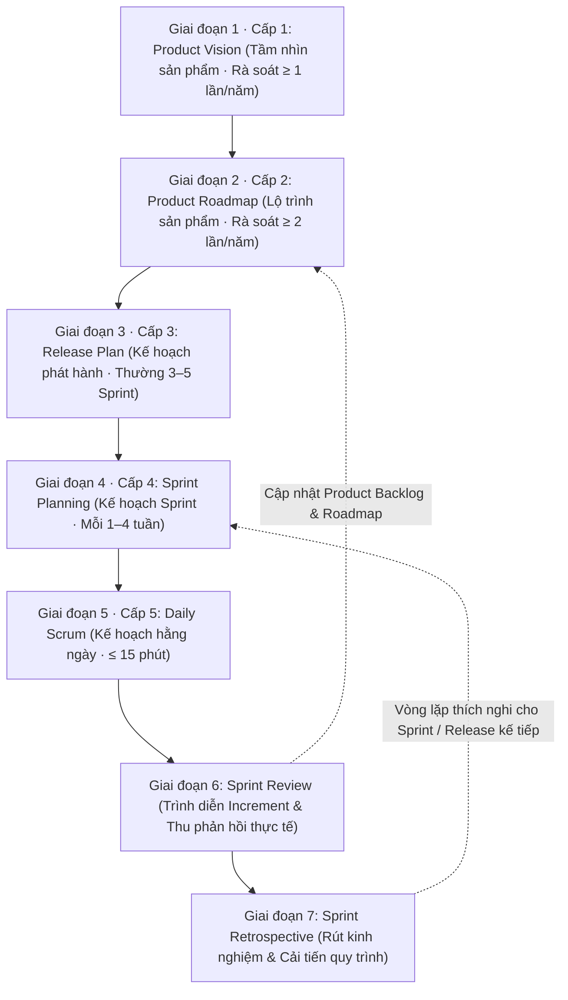

import QuickCheck from '../../../components/QuickCheck.astro';
import Quiz from '../../../components/Quiz.astro';
import ReflectBox from '../../../components/ReflectBox.astro';
import Term from '../../../components/Term.astro';

## Mục tiêu bài học (Thang Bloom)

Bài học này tổng hợp các khung tư duy nền tảng của cuốn ***Agile Project Management For Dummies* (4th Edition — Mark C. Layton, Steven J. Ostermiller & Dean J. Kynaston)** để giúp bạn nhìn thấy **bức tranh quản trị trọn vẹn từ chiến lược sản phẩm xuống tới công việc hằng ngày**:

- **Phân biệt** rõ **Tam giác Sắt truyền thống** và **<Term id="inverted-triangle">Tam giác Sắt Đảo ngược (Inverted Iron Triangle)</Term>** của Agile.
- **Trình bày** được **7 giai đoạn của <Term id="roadmap-to-value">Roadmap to Value</Term>** và sự liên kết trực tiếp với **5 Cấp độ Lập kế hoạch Agile**.
- **Viết được** một tuyên bố tầm nhìn **<Term id="elevator-statement">Elevator Statement</Term>** cô đọng cho sản phẩm phần mềm.
- **Giải thích** cách Agile kiểm soát Phạm vi, Thời gian, Chi phí, Rủi ro và Chất lượng mà không bị rơi vào tình trạng hỗn loạn.

---

## 1. Tam giác Sắt Đảo ngược (The Inverted Iron Triangle)

Sự khác biệt lớn nhất giữa quản lý dự án truyền thống (Waterfall) và quản lý dự án Agile nằm ở cách kiểm soát 3 ràng buộc kinh điển (**Phạm vi – Thời gian – Chi phí**) xoay quanh **Chất lượng**:

  

    
Truyền thống (Waterfall): Khóa Phạm vi

    <ul>
      <li><strong>Cố định (Fixed):</strong> Phạm vi (Scope) — cố gắng chốt 100% yêu cầu từ đầu.</li>
      <li><strong>Biến đổi (Estimated / Variable):</strong> Thời gian & Chi phí.</li>
      <li><strong>Hệ quả thực tế:</strong> Vì yêu cầu luôn phát sinh ẩn số, dự án thường xuyên trễ hạn, đội ngân sách — hoặc tệ hơn là bị ép cắt giảm Chất lượng (bỏ test) để kịp ngày ra mắt.</li>
    </ul>
  

  

    
Agile (Inverted Triangle): Khóa Thời gian & Chi phí

    <ul>
      <li><strong>Cố định (Fixed):</strong> Thời gian (nhịp Sprint cố định), Chi phí (đội ngũ ổn định) và chuẩn Chất lượng (DoD).</li>
      <li><strong>Linh hoạt (Variable):</strong> Phạm vi (Scope) — luôn sắp xếp ưu tiên để làm phần giá trị cao nhất trước.</li>
      <li><strong>Hệ quả thực tế:</strong> Luôn có sản phẩm chất lượng cao đúng hẹn, đúng ngân sách; nếu cần thêm tính năng mới thì <em>đổi chỗ</em> minh bạch với tính năng ít giá trị hơn.</li>
    </ul>
  

:::caution[Không bao giờ được đánh đổi Chất lượng]
Trong cả hai mô hình, nếu cố khóa cứng **cả 3 yếu tố** Phạm vi + Thời gian + Chi phí mà vẫn nhồi thêm yêu cầu mới, thứ duy nhất bị hy sinh sẽ là **Chất lượng** — dẫn tới nợ kỹ thuật và chi phí sửa lỗi khổng lồ sau này.
:::

---

## 2. Khung "Roadmap to Value" (7 giai đoạn) & 5 Cấp độ Lập kế hoạch Agile

Một hiểu lầm cực kỳ phổ biến là *"Agile không lập kế hoạch"*. Thực tế, cuốn *Agile Project Management For Dummies* chỉ ra Agile lập kế hoạch **nhiều hơn và sát thực tế hơn** truyền thống — thông qua **5 cấp độ tinh chỉnh dần (Progressive Elaboration)** gắn liền với **7 giai đoạn của Lộ trình tới Giá trị (Roadmap to Value)**:

### Bảng chi tiết 7 giai đoạn (từ chiến lược tới thực thi)

| Giai đoạn | Cấp lập kế hoạch | Ai dẫn dắt chính | Đầu ra cụ thể | Tần suất rà soát |
|---|---|---|---|---|
| **1. Product Vision** | Cấp 1 (Vĩ mô nhất) | Product Owner + Sponsor | Tuyên bố tầm nhìn (**Elevator Statement**) | Ít nhất 1 lần/năm |
| **2. Product Roadmap** | Cấp 2 | Product Owner + Stakeholders | Lộ trình cụm tính năng & mốc quý; khởi tạo Product Backlog | Ít nhất 2 lần/năm |
| **3. <Term id="release-plan">Release Plan</Term>** | Cấp 3 | Scrum Team + Stakeholders | Mục tiêu & phạm vi dự kiến cho 1 đợt phát hành (**3–5 Sprint**) | Mỗi đợt phát hành |
| **4. Sprint Planning** | Cấp 4 | Cả Scrum Team | **Sprint Goal** + **Sprint Backlog** | Đầu mỗi Sprint (1–4 tuần) |
| **5. Daily Scrum** | Cấp 5 (Vi mô nhất) | Developers | Kế hoạch phối hợp 24 giờ tới, làm lộ trở ngại sớm | Hằng ngày (≤ 15 phút) |
| **6. Sprint Review** | *(Thanh tra sản phẩm)* | Scrum Team + Key Stakeholders | Increment được góp ý thực tế + Product Backlog cập nhật | Cuối mỗi Sprint |
| **7. Sprint Retrospective** | *(Cải tiến quy trình)* | Nội bộ Scrum Team | 1–2 hành động cải tiến cụ thể cho Sprint sau | Cuối mỗi Sprint |

<QuickCheck
  id="qc-as0-1"
  question="Một nhóm Agile chạy thẳng vào Sprint 1 mà không xây Product Vision, Product Roadmap hay Release Plan. Theo khung 5 Cấp độ Lập kế hoạch, họ đang thiếu 3 tầng nào và hậu quả dễ gặp nhất là gì?"
  options={[
    "Thiếu Cấp 1–3 (Vision, Roadmap, Release Plan) → các tính năng làm ra dễ rời rạc, thiếu định hướng giá trị chung và không trả lời được lãnh đạo khi nào có bản phát hành hoàn chỉnh.",
    "Không thiếu gì vì Scrum chỉ cần biết 2 tuần tới làm gì.",
    "Chỉ thiếu Daily Scrum.",
    "Thiếu biểu đồ Gantt chi tiết từng giờ cho cả 2 năm."
  ]}
  correctIndex={0}
  explanation="Sprint Planning (Cấp 4) và Daily Planning (Cấp 5) cần đứng trên nền của Vision (Cấp 1), Roadmap (Cấp 2) và Release Plan (Cấp 3) để đảm bảo mọi Sprint đều tiến về một mục tiêu giá trị thống nhất."
/>

---

## 3. Cách viết Product Vision bằng mẫu "Elevator Statement"

Ở Giai đoạn 1 (*Chapter 7 – Agile Project Management For Dummies*), Product Owner tóm gọn tầm nhìn sản phẩm thành một câu **Elevator Statement** (đủ ngắn để trình bày trong thời gian đi thang máy) theo cấu trúc chuẩn:

> - **Dành cho** `[nhóm khách hàng / người dùng mục tiêu]`
> - **những người đang cần** `[vấn đề / nhu cầu cốt lõi cần giải quyết]`
> - **Sản phẩm** `[Tên sản phẩm]` **là một** `[loại hệ thống / danh mục]`
> - **mang lại lợi ích** `[giá trị then chốt, lý do thuyết phục nhất]`
> - **Khác với** `[cách làm hiện tại / đối thủ]`
> - **sản phẩm của chúng ta** `[điểm khác biệt cốt lõi]`.

### Ví dụ Elevator Statement cho Dự án mô phỏng Thư viện (LibCore)
- **Dành cho** 18.000 sinh viên, giảng viên và đội ngũ 12 thủ thư của Trường Đại học Bình Minh,
- **những người đang cần** tra cứu sách tức thì trên di động và rút ngắn thời gian mượn/trả tại quầy dưới 30 giây,
- **LibCore** là một **hệ thống quản lý thư viện số đa nền tảng**,
- **mang lại lợi ích** tự động hóa toàn bộ quy trình mượn–trả–nhắc hạn–tính phạt và cung cấp báo cáo kho sách theo thời gian thực.
- **Khác với** phần mềm cũ từ năm 2012 kết hợp sổ Excel rời rạc,
- **LibCore** tích hợp đăng nhập SSO sẵn có của trường, quét mã vạch siêu nhanh và giảm tỷ lệ thất lạc sách từ 18% xuống dưới 5%.

---

## 4. Quản trị Rủi ro, Ngân sách & Hợp đồng trong Agile (Part 4)

Cuốn *Agile Project Management For Dummies* (Phần 4) nhấn mạnh 4 nguyên lý giúp Agile vẫn cực kỳ chặt chẽ về mặt quản trị dự án:

1. **Giảm rủi ro sớm (Risk Burndown):** Sắp xếp các hạng mục có **giá trị cao và rủi ro cao** lên đầu Product Backlog để kiểm chứng sớm (fail fast, learn fast) thay vì giấu rủi ro tới cuối dự án.
2. **Phân cấp yêu cầu từ lớn tới nhỏ:** `Product Vision` → `Product Roadmap (Themes)` → `Epics` → `User Stories` → `Tasks` — chỉ chi tiết hóa tối đa các mục sắp làm trong 1–2 Sprint tới.
3. **Kiểm soát chi phí theo nhịp Sprint:** Vì kích thước đội ổn định, **chi phí mỗi Sprint (Burn Rate)** biết chính xác ngay từ đầu. Doanh nghiệp có thể dừng phát triển sớm ngay khi giá trị cốt lõi đã đạt đủ (nguyên lý 80/20) thay vì bắt buộc tiêu hết 100% ngân sách.
4. **Hợp đồng Agile linh hoạt:** Thay vì hợp đồng khóa cứng phạm vi 200 trang dễ gây tranh chấp Change Request, dùng hợp đồng theo từng giai đoạn/Sprint (Time & Materials có trần ngân sách, hoặc Fixed-Price cho từng Release nhỏ có quyền đổi tính năng tương đương — *"Money for Nothing, Change for Free"*).

---

## 5. Tự giải thích & Kiểm tra thành thạo

<ReflectBox
  lessonId="as-0"
  prompt="Hãy giải thích bằng 3–4 câu theo tinh thần Agile Project Management For Dummies: (1) Tam giác Sắt Đảo ngược hoạt động thế nào, (2) 5 cấp độ lập kế hoạch Agile gồm những cấp nào, và (3) Vì sao không được bỏ qua Product Vision & Release Plan khi chạy Scrum?"
  sampleKeyPoints={[
    "Tam giác Sắt Đảo ngược cố định Thời gian (Sprint), Chi phí (đội ổn định) và chuẩn Chất lượng, còn Phạm vi linh hoạt sắp ưu tiên để tối đa hóa giá trị.",
    "5 cấp độ lập kế hoạch đi từ vĩ mô xuống vi mô: Product Vision → Product Roadmap → Release Planning → Sprint Planning → Daily Planning (gắn với 7 giai đoạn Roadmap to Value).",
    "Nếu thiếu Vision, Roadmap và Release Plan, các Sprint dễ tạo ra tính năng rời rạc không hướng tới mục tiêu kinh doanh và không dự báo được thời điểm phát hành hoàn chỉnh."
  ]}
/>

<Quiz quizId="as-0" />

---

## Nguồn tham khảo

- **Mark C. Layton, Steven J. Ostermiller & Dean J. Kynaston**, *Agile Project Management For Dummies* (4th Edition, Wiley):
  - **Part 1 (Understanding Agility):** Tam giác Sắt Đảo ngược & vì sao Agile hiệu quả.
  - **Part 3 (Ch. 7–11):** Khung **Roadmap to Value (7 giai đoạn)**, **5 Cấp độ Lập kế hoạch Agile**, **Elevator Statement**, Release Planning & Sprint Execution.
  - **Part 4 (Project Management with Agility):** Quản trị Phạm vi, Thời gian, Chi phí, Rủi ro và Hợp đồng trong Agile.
