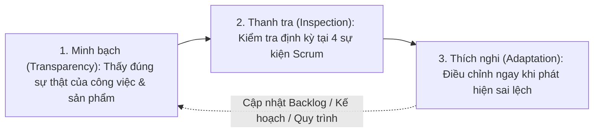

import QuickCheck from '../../../components/QuickCheck.astro';
import Quiz from '../../../components/Quiz.astro';
import ReflectBox from '../../../components/ReflectBox.astro';
import Term from '../../../components/Term.astro';

## Mục tiêu bài học (Thang Bloom)

Sau khi học xong bài này, bạn sẽ có khả năng:
- **Giải thích & Áp dụng** toàn bộ **12 nguyên tắc của Tuyên ngôn Agile (2001)** vào tình huống dự án thực tế (không chỉ thuộc lòng khẩu hiệu).
- **Phân tích** mối quan hệ phụ thuộc giữa **3 trụ cột Chủ nghĩa Kinh nghiệm (<Term id="empiricism">Empiricism</Term>)** trong Scrum: Minh bạch, Thanh tra, Thích nghi.
- **Nhận diện** những dấu hiệu khi đội ngũ vi phạm **5 Giá trị Scrum (<Term id="scrum-values">Scrum Values</Term>)** và cách xử lý.

---

## 1. Trọn bộ 12 Nguyên tắc Agile & Cách nhận diện ngoài thực tế

Nhiều đội thuộc lòng 4 giá trị nhưng bỏ qua **12 nguyên tắc** — chính 12 nguyên tắc này mới là "kim chỉ nam hành vi" giải thích tại sao Scrum/Kanban/XP vận hành như vậy:

| # | Nguyên tắc Agile (2001) | Biểu hiện ĐÚNG ngoài thực tế | Dấu hiệu VI PHẠM hay gặp |
|---|---|---|---|
| **1** | Ưu tiên cao nhất là làm hài lòng khách hàng qua việc bàn giao sớm và liên tục phần mềm giá trị | Giao tính năng lõi dùng được sau 2–4 tuần | Làm âm thầm 6 tháng rồi mới cho khách xem |
| **2** | Chào đón thay đổi yêu cầu, kể cả ở giai đoạn muộn, để tạo lợi thế cạnh tranh | Đưa thay đổi vào Product Backlog, sắp ưu tiên & đổi món minh bạch | Đóng băng yêu cầu 1 năm hoặc nhét thay đổi vô tội vạ vào giữa Sprint |
| **3** | Bàn giao phần mềm chạy được thường xuyên (vài tuần đến vài tháng, càng ngắn càng tốt) | Nhịp Sprint 1–4 tuần, luôn tạo Increment đạt DoD | Làm 5 Sprint không có bản nào chạy trọn vẹn |
| **4** | Người làm nghiệp vụ và lập trình viên phải làm việc cùng nhau hằng ngày | BA/PO ngồi sát đội kỹ thuật, giải đáp vướng mắc trong ngày | Ném file đặc tả qua email rồi 2 tuần sau mới gặp lại |
| **5** | Xây dựng dự án quanh những cá nhân có động lực; trao môi trường, hỗ trợ và tin tưởng họ hoàn thành việc | Đội tự quản cách làm kỹ thuật, không bị soi từng giờ | Quản lý vi mô, chỉ định từng dòng code |
| **6** | Cách truyền đạt hiệu quả nhất là trò chuyện trực tiếp (face-to-face / gọi trực tiếp) | Gặp trực tiếp 5 phút làm rõ thay vì gửi qua lại 20 email | Chỉ giao tiếp qua ticket dài hàng trang, đổ lỗi lẫn nhau |
| **7** | **Phần mềm chạy được là thước đo chính của tiến độ** | Đo bằng Increment đạt DoD đã kiểm thử | Đo tiến độ bằng "% số trang đặc tả" hay "% giờ đã đốt" |
| **8** | Phát triển bền vững: duy trì nhịp độ ổn định lâu dài (Sustainable pace) | Công suất ổn định qua nhiều Sprint, tránh kiệt sức | Tăng ca triền miên (death march), chất lượng lao dốc |
| **9** | Liên tục quan tâm tới sự xuất sắc về kỹ thuật và thiết kế tốt | Refactoring, code review, CI/CD, kiểm thử tự động | "Cứ code bừa cho chạy đã, dọn sau" → vỡ nợ kỹ thuật |
| **10** | Sự đơn giản — **nghệ thuật tối đa hóa lượng công việc KHÔNG cần làm** | Dám bỏ những tính năng phức tạp ít giá trị (80/20) | Xây hàng tá tính năng "phòng khi sau này cần" |
| **11** | Kiến trúc, yêu cầu và thiết kế tốt nhất đến từ các đội tự tổ chức | Cả đội cùng phản biện thiết kế thay vì 1 người áp đặt từ trên xuống | Kiến trúc sư "tháp ngà" vẽ giấy không biết thực tế code |
| **12** | Định kỳ suy ngẫm cách làm hiệu quả hơn rồi điều chỉnh hành vi tương ứng | Sprint Retrospective có hành động cải tiến cụ thể | Họp rút kinh nghiệm cho có, Sprint nào cũng lặp lỗi cũ |

---

## 2. Chủ nghĩa Kinh nghiệm (Empiricism) — Động cơ của Scrum

Tại sao Scrum không cố dự đoán hoàn hảo mọi chi tiết của 12 tháng tới? Bởi vì phát triển phần mềm nằm trong miền **phức tạp (Complex)** — ẩn số nhiều hơn điều đã biết. Do đó Scrum vận hành dựa trên **Chủ nghĩa Kinh nghiệm** qua 3 trụ cột liên hoàn:

- **Nếu thiếu Minh bạch:** Thanh tra trở nên sai lệch (ví dụ: báo cáo "xong 90%" nhưng thực ra chưa test một dòng nào).
- **Nếu Thanh tra mà không Thích nghi:** Chỉ là họp cho vui (ví dụ: thấy khách chê luồng đặt sách khó dùng trong Sprint Review nhưng vẫn giữ nguyên không đổi Backlog).

<QuickCheck
  id="qc-as1-1"
  question="Đội Scrum nhận thấy 3 Sprint liên tiếp đều bị trễ vì chờ duyệt môi trường triển khai mất 4 ngày, nhưng trong Sprint Retrospective không ai đề xuất hành động tháo gỡ mà chỉ thở dài cho qua. Trụ cột nào của Empiricism đang bị đứt gãy?"
  options={[
    "Đứt gãy ở Minh bạch (không ai biết vấn đề).",
    "Đứt gãy ở Thích nghi (đã thấy và thanh tra ra vấn đề nhưng không điều chỉnh để khắc phục).",
    "Đứt gãy ở tốc độ lập trình.",
    "Không đứt gãy gì vì nhóm đã họp đúng lịch."
  ]}
  correctIndex={1}
  explanation="Nhóm đã thấy rõ vấn đề (Minh bạch) và nhận diện nó (Thanh tra), nhưng không hành động để thay đổi (Thích nghi) — khiến vòng lặp kinh nghiệm trở nên vô nghĩa."
/>

---

## 3. 5 Giá trị Scrum (Scrum Values) trong tình huống đời thực

Scrum Guide 2020 nhấn mạnh: **3 trụ cột kinh nghiệm chỉ sống được khi tồn tại 5 Giá trị Scrum** (mẹo nhớ: **C – F – O – R – C**):

| Giá trị | Ý nghĩa thực chiến | Tình huống thể hiện ĐÚNG | Tình huống VI PHẠM |
|---|---|---|---|
| **Commitment** (Cam kết) | Cam kết đạt mục tiêu chung và hỗ trợ nhau (KHÔNG phải hứa mù quáng phạm vi phi thực tế) | Cả đội cùng chung tay gỡ bug cản Sprint Goal | "Việc của tôi xong rồi, phần QA test không kịp mặc kệ" |
| **Focus** (Tập trung) | Tập trung tối đa vào công việc Sprint để tạo tiến triển tốt nhất hướng tới mục tiêu | Hoàn tất từng Story trọn vẹn thay vì mở 10 việc cùng lúc | Vừa làm Sprint vừa nhận 5 việc vặt ngoài luồng |
| **Openness** (Cởi mở) | Trung thực về tiến độ, khó khăn và đón nhận góp ý | Báo ngay trong Daily khi phát hiện kẹt tích hợp | Giấu lỗi tới ngày cuối Sprint vì sợ bị trách |
| **Respect** (Tôn trọng) | Tôn trọng năng lực, quan điểm độc lập của từng thành viên | Tranh luận gay gắt về giải pháp nhưng không công kích cá nhân | Đổ lỗi cá nhân trong Retrospective hoặc bác bỏ ý kiến người mới |
| **Courage** (Dũng cảm) | Dám làm điều đúng đắn và đối mặt bài toán khó | Dám nói "Không" với yêu cầu phi thực tế hoặc từ chối hạ chuẩn DoD | Sợ mất lòng sếp nên nhận bừa khối lượng gấp đôi năng lực |

---

## 4. Tự giải thích & Kiểm tra thành thạo

<ReflectBox
  lessonId="as-1"
  prompt="Hãy giải thích bằng 3–4 câu: (1) Vì sao 'Phần mềm chạy được' là thước đo tiến độ thật trong Agile, (2) Nếu thiếu Minh bạch thì Thanh tra và Thích nghi sẽ ra sao, và (3) Cam kết (Commitment) trong Scrum khác gì với 'hứa bừa mọi phạm vi sếp giao'?"
  sampleKeyPoints={[
    "Tài liệu hay số giờ làm việc không chứng minh sản phẩm hoạt động; chỉ phần mềm chạy được đạt chuẩn chất lượng mới phản ánh tiến độ thực.",
    "Ba trụ cột Empiricism liên kết chặt: thiếu Minh bạch làm Thanh tra sai lệch và dẫn tới quyết định Thích nghi sai lầm.",
    "Commitment trong Scrum là cam kết cống hiến tối đa hướng tới mục tiêu chung và giữ chất lượng, kết hợp cùng Courage để nói rõ năng lực thực tế thay vì hứa bừa."
  ]}
/>

<Quiz quizId="as-1" />

---

## Nguồn tham khảo

- **Agile Manifesto (2001)** — 12 Principles behind the Agile Manifesto.
- **Ken Schwaber & Jeff Sutherland**, *The Scrum Guide (2020)* — Scrum Theory & Scrum Values.
