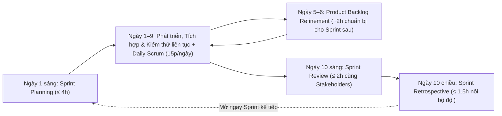

import QuickCheck from '../../../components/QuickCheck.astro';
import Quiz from '../../../components/Quiz.astro';
import ReflectBox from '../../../components/ReflectBox.astro';
import Term from '../../../components/Term.astro';

## Mục tiêu bài học (Thang Bloom)

Sau khi học xong bài này, bạn sẽ có khả năng:
- **Mô tả chính xác** ranh giới quyền hạn và trách nhiệm của **Product Owner**, **Scrum Master** và **Developers**.
- **Điều phối hoặc tham gia đúng chuẩn** cả **5 sự kiện Scrum** (nắm rõ mục đích, time-box, đầu vào, đầu ra và ai tham gia).
- **Thiết lập** quy trình **<Term id="refinement">Product Backlog Refinement</Term>** liên tục để tránh Sprint Planning kéo dài lê thê.
- **Xây dựng** được bộ **<Term id="dor">Definition of Ready (DoR)</Term>** và **<Term id="dod">Definition of Done (DoD)</Term>** cụ thể cho một dự án phần mềm.

---

## 1. Nhịp vận hành thực tế của một Sprint 2 tuần (10 ngày làm việc)

:::note[Lưu ý cực hay bị hỏi trong đề thi PSM I]
Không có khoảng trống ("tuần nghỉ") giữa hai Sprint: **Sprint mới bắt đầu ngay lập tức sau khi kết thúc Sprint trước**. Ngoài ra, Increment đạt DoD **có thể được phát hành bất cứ ngày nào ngay trong Sprint**, không cần chờ tới Sprint Review!
:::

---

## 2. Chi tiết 3 Trách nhiệm (Accountabilities) theo Scrum Guide 2020

Scrum Team lý tưởng có quy mô **≤ 10 người**, **đa chức năng (cross-functional)** và **tự quản (self-managing)** — tức nội bộ đội tự quyết ai làm việc gì, khi nào và như thế nào.

| Trách nhiệm | Sở hữu trực tiếp | Phải làm (DO) | Không được làm (DON'T) |
|---|---|---|---|
| **Product Owner** *(1 người duy nhất)* | **Product Backlog** & tối đa hóa giá trị sản phẩm | Truyền đạt <Term id="product-goal">Product Goal</Term>; sắp xếp thứ tự Backlog; tương tác Stakeholders; là người duy nhất có quyền hủy Sprint nếu Sprint Goal lỗi thời | Không ủy quyền thành hội đồng 3–4 người; không áp đặt cách làm kỹ thuật hay ép khối lượng công việc vượt khả năng Developers |
| **Developers** *(gồm cả Dev, QA, UI/UX, BA kỹ thuật...)* | **Sprint Backlog** & chất lượng **Increment** | Tạo kế hoạch thực thi Sprint; giữ chất lượng theo DoD; tự điều chỉnh kế hoạch mỗi ngày tại Daily Scrum; giữ trách nhiệm lẫn nhau | Không để từng cá nhân tách rời kiểu "Dev xong rồi vứt cho QA"; không tự ý nhận việc ngoài luồng bỏ qua PO |
| **Scrum Master** *(Lãnh đạo phục vụ)* | Hiệu quả vận hành Scrum trong nhóm & tổ chức | Huấn luyện nhóm tự quản; hỗ trợ PO quản lý backlog hiệu quả; gỡ bỏ trở ngại vượt tầm đội; thúc đẩy môi trường làm việc an toàn | Không đóng vai "thư ký ghi biên bản/chấm công" và cũng không đóng vai "sếp ra lệnh phân việc" |

---

## 3. Bảng vận hành chi tiết 5 Sự kiện Scrum (Time-box chuẩn)

| Sự kiện | Time-box (Sprint 1 tháng / 2 tuần) | Ai tham gia | Mục đích cốt lõi (Thanh tra & Thích nghi cái gì?) | Đầu ra chính |
|---|---|---|---|---|
| **1. Sprint** | ≤ 1 tháng / 2 tuần | Cả Scrum Team | Vỏ chứa cố định thời gian để biến ý tưởng thành giá trị (Increment) | ≥ 1 Increment đạt DoD |
| **2. Sprint Planning** | ≤ 8h / ~4h | Cả Scrum Team (+ chuyên gia tư vấn nếu cần) | Trả lời **3 chủ đề**: **(1) Why** – Vì sao Sprint này giá trị? **(2) What** – Làm được những mục nào? **(3) How** – Thực hiện ra sao? | **<Term id="sprint-goal">Sprint Goal</Term>** + **Sprint Backlog** |
| **3. Daily Scrum** | **≤ 15 phút** (mọi Sprint) | **Developers** (PO/SM tham dự nếu họ đang làm việc trên Sprint Backlog) | Kiểm tra tiến độ hướng tới Sprint Goal & điều chỉnh kế hoạch 24 giờ tới | Kế hoạch hành động 24h tới (đồng bộ gỡ tắc nghẽn) |
| **4. Sprint Review** | ≤ 4h / ~2h | Scrum Team + **Key Stakeholders** | Thanh tra **Increment chạy thật** & môi trường kinh doanh → thích nghi Product Backlog | Product Backlog cập nhật theo phản hồi thực tế |
| **5. Sprint Retrospective** | ≤ 3h / ~1.5h | **Chỉ nội bộ Scrum Team** | Thanh tra con người, tương tác, quy trình, công cụ và DoD → cải tiến cách làm | 1–2 hành động cải tiến cụ thể cho Sprint sau |

<QuickCheck
  id="qc-as2-1"
  question="Nhóm Scrum 2 tuần gặp tình trạng: trong buổi Sprint Review, sếp và khách hàng chỉ ngồi xem 10 slide PowerPoint tóm tắt số lượng ticket đã đóng mà không được thao tác thử phần mềm thật. Điểm yếu cốt lõi ở đây là gì?"
  options={[
    "Slide PowerPoint chưa đủ màu sắc.",
    "Không thanh tra được Increment thực tế (vi phạm trụ cột Minh bạch và nguyên tắc #7 'Phần mềm chạy được là thước đo chính'), khiến phản hồi của khách hàng kém chính xác.",
    "Sprint Review chỉ dành cho nội bộ Developers nên không nên mời khách hàng.",
    "Slide cần làm dài ít nhất 50 trang mới đạt chuẩn Scrum."
  ]}
  correctIndex={1}
  explanation="Sprint Review là buổi làm việc tương tác trực tiếp trên Increment đang chạy để khách hàng trải nghiệm thật và cùng cập nhật Product Backlog."
/>

---

## 4. Product Backlog Refinement — Bí quyết để Sprint Planning không bị "vỡ trận"

**Product Backlog Refinement** KHÔNG phải là sự kiện thứ 6 bắt buộc khung giờ cứng, mà là **hoạt động liên tục** xuyên suốt Sprint (thường chiếm 5–10% thời gian của đội):
- **Làm gì trong Refinement?** PO, BA và đại diện Developers/QA cùng xem trước các mục nằm trên đầu Product Backlog (dự kiến làm trong 1–2 Sprint tới) để:
  1. Làm rõ luồng nghiệp vụ và các trường hợp ngoại lệ.
  2. Chia nhỏ các mục quá to (Vertical Slicing).
  3. Viết rõ Tiêu chí chấp nhận (Acceptance Criteria).
  4. Ước lượng sơ bộ độ phức tạp và phát hiện sớm phụ thuộc kỹ thuật.

---

## 5. Definition of Ready (DoR) vs Definition of Done (DoD)

Hãy phân biệt thật rõ hai khái niệm này — rất hay xuất hiện trong phỏng vấn BA, PO và Scrum Master:

| Tiêu chí | Definition of Ready (DoR) | Definition of Done (DoD) |
|---|---|---|
| **Vị trí** | Cổng chuẩn bị **ĐẦU VÀO** trước khi đưa vào Sprint | Cam kết chất lượng **ĐẦU RA** của mỗi Increment |
| **Vị thế trong Scrum Guide 2020** | Thực hành bổ trợ (không bắt buộc — tránh biến thành thủ tục cứng nhắc) | **BẮT BUỘC** (Commitment chính thức của Artifact Increment) |
| **Ví dụ cho dự án Thư viện LibCore** | 1) User Story rõ vai trò–mục tiêu–giá trị 2) Có tiêu chí chấp nhận Given/When/Then 3) Đã có wireframe màn hình (nếu có UI) 4) Đủ nhỏ để xong trong 1 Sprint (≤ 8 điểm) 5) Đã rõ phụ thuộc API/SSO | 1) Code đã qua Pull Request review bởi ≥ 1 thành viên khác 2) Unit Test & Integration Test đạt 100% trên CI 3) QA đã kiểm thử đạt toàn bộ tiêu chí chấp nhận, không còn bug mức Cao/Nghiêm trọng 4) Đã triển khai ổn định lên môi trường Staging và cập nhật tài liệu API/HDSD |

:::caution[Khi nào cần nâng cấp DoD?]
Khi nhóm trưởng thành hơn (ví dụ đã dựng xong tự động hóa kiểm thử hiệu năng hoặc quét bảo mật), nhóm sẽ **nâng chuẩn DoD ngày càng chặt hơn** trong Sprint Retrospective để chất lượng sản phẩm liên tục tăng lên.
:::

---

## 6. Tự giải thích & Kiểm tra thành thạo

<ReflectBox
  lessonId="as-2"
  prompt="Hãy giải thích bằng 3–4 câu: (1) Sprint Planning trả lời 3 câu hỏi nào, (2) Vì sao Product Backlog Refinement lại cần thiết, và (3) DoR khác DoD ở điểm nào?"
  sampleKeyPoints={[
    "Sprint Planning trả lời 3 chủ đề: Why (chốt Sprint Goal), What (chọn các mục từ Product Backlog), và How (Developers lập kế hoạch triển khai thành Sprint Backlog).",
    "Product Backlog Refinement diễn ra liên tục trong Sprint giúp làm rõ yêu cầu, chia nhỏ Story và phát hiện phụ thuộc trước khi bước vào Sprint Planning.",
    "DoR là hướng dẫn chuẩn bị đầu vào để Story đủ rõ trước khi làm; DoD là cam kết bắt buộc trong Scrum Guide xác định chuẩn chất lượng đầu ra để Increment được tính là hoàn thành."
  ]}
/>

<Quiz quizId="as-2" />

---

## Nguồn tham khảo

- **Ken Schwaber & Jeff Sutherland**, *The Scrum Guide (2020)* — Toàn bộ phần Scrum Team, Scrum Events và Scrum Artifacts.
- **Scrum.org**, *Professional Scrum Master (PSM I) Learning Path* — Mastering Scrum Events & DoD.
