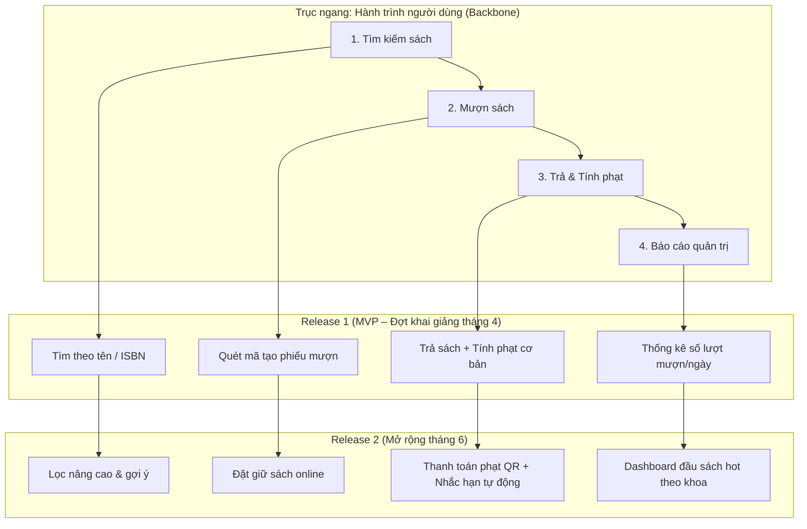

import QuickCheck from '../../../components/QuickCheck.astro';
import Quiz from '../../../components/Quiz.astro';
import ReflectBox from '../../../components/ReflectBox.astro';
import Term from '../../../components/Term.astro';

## Mục tiêu bài học (Thang Bloom)

Sau khi học xong bài này, bạn sẽ có khả năng:
- **Viết được** một User Story đạt đủ 6 tiêu chí **<Term id="invest">INVEST</Term>** kèm Tiêu chí chấp nhận chuẩn **<Term id="bdd-gherkin">Given / When / Then</Term>**.
- **Chia nhỏ (Split)** một tính năng lớn thành các lát cắt dọc (**<Term id="vertical-slicing">Vertical Slicing</Term>**) thay vì cắt ngang theo tầng kỹ thuật.
- **Vẽ và đọc hiểu** một **<Term id="story-mapping">User Story Map</Term>** để quy hoạch bản phát hành (MVP → Release 2).
- **Áp dụng đúng** **<Term id="story-point">Story Point & Planning Poker</Term>**, **<Term id="velocity">Velocity</Term>** và **Burndown Chart** mà không rơi vào các bẫy sai lầm quản trị.

---

## 1. User Story chuẩn & Bộ 3 chữ "C" (Card – Conversation – Confirmation)

Một User Story không phải là "bản đặc tả thu nhỏ" mà là **lời mời cho một cuộc đối thoại** (Ron Jeffries – 3C):
1. **Card (Thẻ mô tả ngắn):**
   > **Là** `[Vai trò người dùng]`, **tôi muốn** `[Hành động / Tính năng]`, **để** `[Giá trị / Lợi ích đạt được]`.
2. **Conversation (Đối thoại):** Các cuộc trao đổi trong Refinement giữa PO, BA, Dev và QA để làm rõ chi tiết, ngoại lệ và thống nhất cách làm.
3. **Confirmation (Tiêu chí chấp nhận – Acceptance Criteria):** Bằng chứng cụ thể để xác nhận hệ thống đã chạy đúng mong đợi (viết chuẩn nhất theo **Given / When / Then**).

### Ví dụ chuẩn trên Dự án Thư viện LibCore

> **Story US-104:** *Là một **Thủ thư**, tôi muốn **hệ thống tự động chặn tạo phiếu mượn khi bạn đọc đang giữ quá 5 cuốn hoặc có sách trễ hạn**, để **đảm bảo đúng quy chế thư viện mà không phải tự tra cứu thủ công**.*
>
> **Tiêu chí chấp nhận (Given / When / Then):**
> - **Kịch bản 1 (Đạt hạn mức):** *Given* sinh viên A đang mượn 5 cuốn sách chưa trả, *When* thủ thư quét thêm mã sách thứ 6, *Then* hệ thống từ chối tạo phiếu và hiển thị thông báo `"Bạn đọc đã đạt giới hạn tối đa 5 cuốn đang mượn"`.
> - **Kịch bản 2 (Có sách quá hạn):** *Given* sinh viên B đang mượn 2 cuốn nhưng có 1 cuốn quá hạn 3 ngày, *When* thủ thư quét mã sách mới, *Then* hệ thống chặn mượn và hiển thị danh sách cuốn đang quá hạn cùng số tiền phạt tạm tính.
> - **Kịch bản 3 (Hợp lệ):** *Given* sinh viên C đang mượn 3 cuốn và không có cuốn nào quá hạn, *When* thủ thư quét 1 cuốn có trạng thái `Sẵn sàng`, *Then* phiếu mượn được tạo thành công với hạn trả mặc định `+14 ngày`.

---

## 2. Đánh giá chất lượng Story bằng tiêu chí INVEST

| Chữ | Ý nghĩa | Ví dụ ĐẠT | Ví dụ VI PHẠM |
|---|---|---|---|
| **I** – Independent | Độc lập tối đa, dễ đảo thứ tự ưu tiên | Story "Tra cứu sách theo tên" không bị khóa cứng vào "Báo cáo cuối năm" | 3 Story dính chùm không thể hoàn thành nếu thiếu nhau |
| **N** – Negotiable | Tập trung vào *nhu cầu*, mở không gian thương lượng *giải pháp* | "Nhắc bạn đọc trước hạn trả 2 ngày" (có thể bàn chọn email hay thông báo app) | "Phải dùng đúng bảng SQL tên `TBL_REMIND` với 12 cột cứng..." |
| **V** – Valuable | Mang lại giá trị hữu hình cho người dùng hoặc nghiệp vụ | "Xuất biên lai thu tiền phạt trễ hạn" | "Tạo 5 bảng cơ sở dữ liệu trống" (người dùng không thấy giá trị gì) |
| **E** – Estimable | Đủ rõ để đội ước lượng độ phức tạp tương đối | Đã rõ quy tắc tính phạt và ngoại lệ | "Tích hợp AI gợi ý sách thông minh" (quá mơ hồ chưa nghiên cứu) |
| **S** – Small | Đủ nhỏ để hoàn thành trọn vẹn (đạt DoD) trong 1 Sprint | 2–5 Story Points (làm xong trong 2–4 ngày) | Epic 40 điểm kéo dài 2 tháng |
| **T** – Testable | Có tiêu chí rõ ràng để kiểm thử đúng/sai khách quan | "Hiển thị kết quả tìm kiếm trong ≤ 1,5 giây" | "Giao diện nhìn phải thật đẹp và mượt" |

---

## 3. Kỹ thuật Chia nhỏ Story: Cắt dọc (Vertical) vs Cắt ngang (Horizontal)

Đây là kỹ năng thực chiến quan trọng nhất phân biệt đội Agile thật với đội làm Mini-Waterfall:

  

    
ĐÚNG: Vertical Slicing (Cắt dọc theo giá trị)

    
Mỗi lát cắt đi xuyên từ <strong>UI → API → Database → Test</strong> cho một luồng giá trị hẹp:

    <ul>
      <li><strong>Lát 1:</strong> Thu tiền phạt tiền mặt + in biên lai cơ bản (chạy thật 100%).</li>
      <li><strong>Lát 2:</strong> Bổ sung thanh toán qua mã QR chuyển khoản.</li>
      <li><strong>Lát 3:</strong> Bổ sung quy trình miễn/giảm phạt có phê duyệt của Giám đốc thư viện.</li>
    </ul>
  

  

    
SAI: Horizontal Slicing (Cắt ngang theo tầng kỹ thuật)

    
Chia Story theo chuyên môn kỹ thuật:

    <ul>
      <li><strong>Sprint 1:</strong> Tạo bảng DB quản lý phạt.</li>
      <li><strong>Sprint 2:</strong> Viết bộ API Backend.</li>
      <li><strong>Sprint 3:</strong> Thiết kế & ghép màn hình Frontend.</li>
    </ul>
    
<em>Hậu quả:</em> Hết Sprint 1 và 2 không có gì chạy để demo, lỗi tích hợp dồn hết sang Sprint 3!

  

### 5 mẹo cắt dọc nhanh theo mô hình SPIDR (Mike Cohn)
1. **S – Spike (Thăm dò):** Nếu vướng ẩn số kỹ thuật/tích hợp (như SSO), tách riêng 1 Spike 1–2 ngày để nghiên cứu trước khi ước lượng Story chính.
2. **P – Paths (Theo nhánh luồng):** Tách luồng chính (Happy Path) làm trước, các nhánh ngoại lệ phức tạp làm ở Story sau.
3. **I – Interface (Theo giao diện):** Làm phiên bản web chuẩn trước, tối ưu cho mobile/máy quét đặc thù sau.
4. **D – Data (Theo loại dữ liệu):** Hỗ trợ 1 loại sách giấy trước, sách điện tử và tạp chí định kỳ sau.
5. **R – Rules (Theo quy tắc nghiệp vụ):** Áp dụng công thức phạt cố định trước, quy tắc bậc thang và miễn giảm phức tạp sau.

---

## 4. User Story Mapping (Jeff Patton) — Nhìn rõ bức tranh toàn cảnh

Product Backlog dạng danh sách phẳng rất dễ khiến đội bị "chìm trong rừng cây mà quên cả khu rừng". **User Story Mapping** tổ chức backlog theo **2 chiều**:

---

## 5. Ước lượng Agile: Story Point, Planning Poker, Velocity & Burndown

### a) Story Point & Planning Poker
- **Story Point** là thước đo **tương đối** kết hợp 3 yếu tố: **Khối lượng việc + Độ phức tạp + Mức độ rủi ro/bất định** (KHÔNG phải số giờ!).
- Chọn 1 Story nhỏ quen thuộc làm **mốc chuẩn (ví dụ = 2 điểm)** rồi so sánh các Story khác theo dãy **Fibonacci: 1, 2, 3, 5, 8, 13, 21**.
- **Planning Poker:** Cả nhóm (Dev + QA) cùng chọn lá bài kín rồi lật đồng thời để tránh hiệu ứng "neo tâm lý" theo sếp/Senior. Nếu có chênh lệch lớn (ví dụ 2 và 8), mời 2 người ở hai đầu giải thích giả định rồi bỏ phiếu lại.

### b) Velocity & Burndown Chart
- **Velocity:** Tổng Story Point của các hạng mục **đạt trọn vẹn DoD** trong mỗi Sprint. Sau 3–4 Sprint, Velocity ổn định (ví dụ trung bình 28–32 điểm/Sprint) giúp dự báo số Sprint cần thiết cho Release.
- **Sprint Burndown Chart:** Biểu đồ thể hiện khối lượng công việc còn lại theo từng ngày trong Sprint — giúp phát hiện sớm dấu hiệu đường nằm ngang (tắc nghẽn hoặc Story quá to).

<QuickCheck
  id="qc-as3-1"
  question="Nhóm Scrum ước lượng một Story là 5 điểm trong Planning Poker. Đến giữa Sprint, công việc phát sinh phức tạp hơn khiến tổng thời gian thực tế mất nhiều hơn dự kiến 2 ngày nhưng cuối cùng vẫn hoàn thành đạt DoD. Cuối Sprint, nhóm ghi nhận bao nhiêu điểm cho Story này vào Velocity?"
  options={[
    "Tăng lên 8 điểm để phản ánh số ngày đã bỏ ra.",
    "Vẫn giữ nguyên 5 điểm như ước lượng ban đầu — vì việc ước lượng đôi khi lớn hơn hoặc nhỏ hơn thực tế sẽ tự cân bằng trong trung bình Velocity qua nhiều Sprint.",
    "Ghi nhận 0 điểm vì ước lượng sai.",
    "Đổi sang tính theo số giờ thực tế."
  ]}
  correctIndex={1}
  explanation="Không bao giờ sửa lại Story Point sau khi đã xong! Velocity là công cụ thực nghiệm: sự chênh lệch tăng/giảm tự nhiên sẽ được phản ánh trung thực vào tốc độ trung bình của nhóm cho các dự báo tương lai."
/>

---

## 6. Tự giải thích & Kiểm tra thành thạo

<ReflectBox
  lessonId="as-3"
  prompt="Hãy giải thích bằng 3–4 câu: (1) Vertical Slicing khác Horizontal Slicing thế nào, (2) Vì sao Planning Poker lại bắt buộc lật bài cùng lúc và mời người cao nhất/thấp nhất giải thích, và (3) Vì sao không được dùng Velocity để so sánh hai nhóm khác nhau?"
  sampleKeyPoints={[
    "Vertical Slicing cắt xuyên suốt từ UI–API–DB theo lát cắt giá trị nhỏ để cuối mỗi Sprint có phần mềm chạy được; Horizontal Slicing cắt theo tầng kỹ thuật khiến nhiều Sprint không có sản phẩm chạy thật.",
    "Lật bài đồng thời tránh ảnh hưởng tâm lý từ người nói trước; thảo luận giữa mức cao nhất và thấp nhất giúp phơi bày rủi ro hoặc cách giải quyết đơn giản hơn.",
    "Story Point có hệ quy chiếu tương đối riêng của từng đội nên Velocity chỉ dùng dự báo nội bộ cho chính đội đó; dùng so sánh hay ép KPI sẽ gây lạm phát điểm giả."
  ]}
/>

<Quiz quizId="as-3" />

---

## Nguồn tham khảo

- **Mike Cohn**, *User Stories Applied* & *Agile Estimating and Planning*.
- **Jeff Patton**, *User Story Mapping*.
- **Gojko Adzic**, *Specification by Example* (Given/When/Then).
- **Bill Wake**, *INVEST in Good Stories, and SMART Tasks*.
