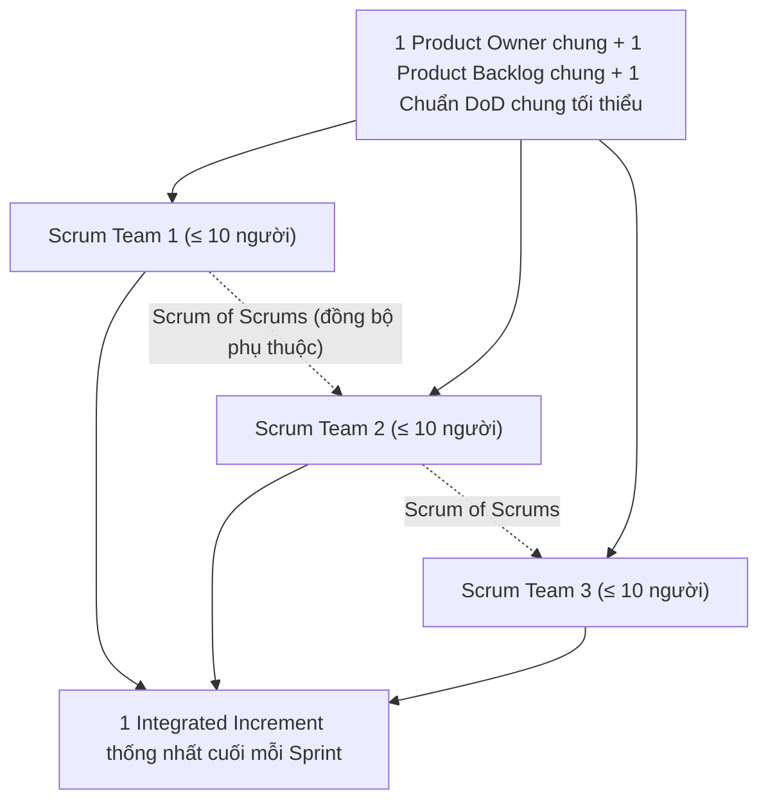

import QuickCheck from '../../../components/QuickCheck.astro';
import Quiz from '../../../components/Quiz.astro';
import ReflectBox from '../../../components/ReflectBox.astro';

## Mục tiêu bài học (Thang Bloom)

Sau khi học xong bài này, bạn sẽ có khả năng:
- **Nhận diện** được **7 loại lãng phí của Lean (7 Wastes of Software Development)** đang ẩn trong dự án phần mềm hằng ngày.
- **Phân biệt** các cách mở rộng Scrum khi có nhiều đội cùng làm một sản phẩm (**Scrum of Scrums, Nexus, LeSS, SAFe**).
- **Áp dụng** các nguyên tắc giữ nhịp hiệu quả cho **đội Agile làm việc từ xa / phân tán (Remote & Distributed Agile)**.
- **Kiểm điểm** dự án bằng danh sách **10 yếu tố quyết định thành công** (từ *Part of Tens — Agile Project Management For Dummies*).

---

## 1. Tư duy Lean & 7 Lãng phí trong phát triển phần mềm (Part 2)

Tư duy **Lean** (nguồn gốc Toyota Production System, được Mary & Tom Poppendieck chuyển hóa sang phần mềm và trình bày trong *Agile Project Management For Dummies*) tập trung vào một mục tiêu: **Tối đa hóa giá trị khách hàng bằng cách loại bỏ lãng phí (Waste)**.

| # | Lãng phí (Lean Waste) | Biểu hiện quen thuộc trong dự án phần mềm | Cách cắt bỏ trong Agile/Scrum |
|---|---|---|---|
| **1** | **Công việc dở dang** (*Partially Done Work*) | Code xong chưa review, viết đặc tả xong để đó 2 tháng, chưa test, chưa triển khai | Giữ WIP thấp, cắt dọc Story và hoàn tất 100% theo **DoD** từng Sprint |
| **2** | **Tính năng thừa** (*Extra Features*) | Xây hàng loạt nút bấm/báo cáo "phòng hờ" mà 80% người dùng không bao giờ bấm tới | Sắp xếp ưu tiên Product Backlog nghiêm ngặt, áp dụng nguyên tắc #10 Agile |
| **3** | **Học lại / Tìm hiểu lại** (*Relearning*) | Không có tài liệu tối thiểu hoặc mã nguồn rối khiến mỗi lần sửa phải đọc lại từ đầu | Code sạch, cặp đôi (Pair Programming), tài liệu sống ngắn gọn |
| **4** | **Bàn giao qua nhiều tầng** (*Handoffs*) | BA ném file cho Architect → Architect ném cho Dev → Dev ném cho QA (mỗi bước rơi rớt 20–50% ngữ cảnh) | **Đội đa chức năng (Cross-functional)** làm việc sát nhau hằng ngày |
| **5** | **Chờ đợi** (*Delays*) | Chờ phê duyệt quyền truy cập, chờ môi trường Test, chờ PO trả lời câu hỏi nghiệp vụ mất 4 ngày | PO đồng hành sát, tự động hóa CI/CD, Scrum Master gỡ rào cản ngay |
| **6** | **Chuyển đổi ngữ cảnh** (*Task Switching*) | Một lập trình viên bị phân làm đồng thời 3 dự án khác nhau (mất 20–40% năng suất chỉ để chuyển não) | Đội chuyên trách ổn định (Dedicated team), tập trung hoàn thành từng mục |
| **7** | **Lỗi phần mềm** (*Defects*) | Lỗi bị phát hiện muộn ở UAT hoặc Production gây sửa dây chuyền tốn kém | **Shift-Left**, TDD, Code Review, kiểm thử tự động ngay trong Sprint |

---

## 2. Mở rộng Agile cho nhiều đội (Scaling Agile — Part 5)

Khi sản phẩm lớn đến mức 1 Scrum Team (≤ 10 người) không làm xuể, bạn **không** phình 1 đội lên 30 người (vì giao tiếp vỡ vụn) mà chia thành nhiều Scrum Team phối hợp trên **cùng một sản phẩm**:

| Khung mở rộng | Quy mô phù hợp | Đặc điểm nhận diện nhanh |
|---|---|---|
| **Scrum of Scrums (SoS)** | 2–5 đội | Buổi họp đồng bộ ngắn (2–3 lần/tuần) giữa đại diện kỹ thuật của các đội để xử lý phụ thuộc chéo |
| **Nexus** *(Scrum.org)* | 3–9 đội | Bám sát Scrum Guide nhất; bổ sung **Nexus Integration Team** để đảm bảo các đội tích hợp thành 1 Increment duy nhất |
| **LeSS** *(Large-Scale Scrum)* | 2–8 đội (hoặc hơn với LeSS Huge) | Tối giản cấu trúc: 1 PO, 1 Product Backlog, giữ nguyên tinh thần Scrum thuần tối đa |
| **SAFe** *(Scaled Agile Framework)* | Tập đoàn lớn (50–1000+ người) | Khung quản trị toàn doanh nghiệp với tầng Team – Program (ART, PI Planning mỗi 8–12 tuần) – Portfolio; đầy đủ nhưng nặng quy trình |

<QuickCheck
  id="qc-as5-1"
  question="Một công ty phân công mỗi lập trình viên tham gia đồng thời 3 dự án Agile khác nhau (30% thời gian mỗi dự án) để 'tận dụng tối đa nhân lực'. Theo tư duy Lean & Agile For Dummies, đây là loại lãng phí nào?"
  options={[
    "Tính năng thừa (Extra Features)",
    "Chuyển đổi ngữ cảnh (Task Switching) — làm hao hụt mạnh năng suất thực và kéo dài Lead Time của cả 3 dự án.",
    "Không có lãng phí gì mà còn tăng tốc cả 3 dự án.",
    "Lãng phí tài liệu."
  ]}
  correctIndex={1}
  explanation="Chuyển đổi ngữ cảnh liên tục giữa nhiều dự án gây mất 20–40% hiệu suất nhận thức và làm tăng mạnh thời gian chờ đợi ở mọi dự án."
/>

---

## 3. Đội Agile làm việc từ xa & Văn hóa tổ chức (Part 5)

Trong thực tế hiện nay, rất nhiều đội làm việc hybrid hoặc remote xuyên thành phố/múi giờ. *Agile Project Management For Dummies* gợi ý 5 nguyên tắc sống còn cho đội phân tán:
1. **Giờ làm việc chồng lấn cốt lõi (Core overlap hours):** Chốt tối thiểu 2–4 giờ/ngày tất cả cùng online để họp Daily, Refinement và trao đổi trực tiếp.
2. **Bật camera & ưu tiên gọi ngắn 5 phút** thay vì nhắn tin qua lại hàng giờ dễ hiểu lầm cảm xúc.
3. **Bảng công việc số minh bạch (Single Source of Truth):** Mọi trạng thái Story, tiêu chí chấp nhận và trở ngại cập nhật thời gian thực trên Jira / Azure DevOps / Linear.
4. **Thỏa thuận làm việc chung (Team Working Agreement):** Thống nhất quy tắc phản hồi tin nhắn, giờ tập trung không làm phiền, chuẩn Pull Request và chuẩn DoD.
5. **Chuyển đổi văn hóa từ "Command & Control" sang "Empower & Trust":** Ban lãnh đạo đo bằng *kết quả giá trị* thay vì đếm *số giờ ngồi trước màn hình*.

---

## 4. 10 Yếu tố quyết định thành công của Agile (Part of Tens)

Tóm gọn tinh hoa từ **Part 6 (The Part of Tens)** của *Agile Project Management For Dummies*:
1. **Tâm thế lãnh đạo ủng hộ (Executive Sponsorship):** Lãnh đạo hiểu Tam giác Đảo ngược và không ép KPI kiểu Waterfall lên đội Agile.
2. **Product Owner đúng nghĩa:** Một cá nhân duy nhất có tầm nhìn, thời gian và quyền ra quyết định ưu tiên.
3. **Đội chuyên trách, đa chức năng và ổn định:** Hạn chế xáo trộn nhân sự giữa chừng và tránh chia nhỏ người qua nhiều dự án.
4. **Tầm nhìn rõ ràng (Product Vision & Roadmap):** Không chạy Sprint mù quáng mà luôn gắn với mục tiêu giá trị.
5. **Khách hàng / Người dùng tham gia phản hồi thật:** Sprint Review có người dùng thật dùng thử sản phẩm.
6. **Cắt nhỏ giá trị theo chiều dọc (Vertical Slicing):** Giao Increment chạy được đều đặn thay vì làm Mini-Waterfall.
7. **Kỷ luật kỹ thuật & DoD nghiêm ngặt:** Không tích tụ nợ kỹ thuật hay dồn bug sang Hardening Sprint.
8. **Minh bạch không trừng phạt (Psychological Safety):** Nói thật về rủi ro sớm để thích nghi kịp thời.
9. **Cải tiến thật sau mỗi Retrospective:** Biến nhận xét thành 1–2 hành động cụ thể được thực thi ở Sprint sau.
10. **Tinh chỉnh phù hợp bối cảnh (Inspect & Adapt):** Học đúng nguyên lý cốt lõi trước rồi thích nghi theo đặc thù tổ chức, tránh áp dụng máy móc hình thức.

---

## 5. Tự giải thích & Kiểm tra thành thạo

<ReflectBox
  lessonId="as-5"
  prompt="Hãy giải thích bằng 3–4 câu: (1) Kể 3 loại lãng phí Lean hay gặp nhất bạn từng thấy trong công việc, (2) Khi mở rộng lên 4 Scrum Team cùng làm 1 sản phẩm cần giữ chung những gì, và (3) Vì sao chia 1 người làm 3 dự án cùng lúc lại gây hại?"
  sampleKeyPoints={[
    "7 lãng phí Lean gồm: công việc dở dang, tính năng thừa, học lại, bàn giao nhiều tầng (handoffs), chờ đợi, chuyển đổi ngữ cảnh (task switching) và lỗi phần mềm.",
    "Khi nhiều Scrum Team cùng làm 1 sản phẩm, bắt buộc dùng chung 1 Product Backlog, 1 Product Owner duy nhất, 1 chuẩn DoD chung tối thiểu và tích hợp thành 1 Increment thống nhất.",
    "Chia nhân sự chạy song song nhiều dự án gây lãng phí chuyển đổi ngữ cảnh (mất 20–40% hiệu suất), phá vỡ sự tập trung và làm chậm thời gian bàn giao của tất cả dự án."
  ]}
/>

<Quiz quizId="as-5" />

---

## Nguồn tham khảo

- **Mark C. Layton, Steven J. Ostermiller & Dean J. Kynaston**, *Agile Project Management For Dummies* (4th Edition) — Part 2 (Lean), Part 5 (Scaling & Culture), Part 6 (The Part of Tens).
- **Mary & Tom Poppendieck**, *Lean Software Development: An Agile Toolkit* (7 Wastes).
- **Scrum.org**, *The Nexus Guide* (Scaling Scrum).
