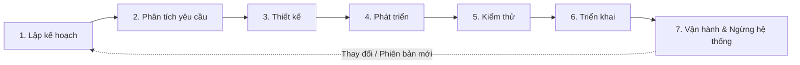
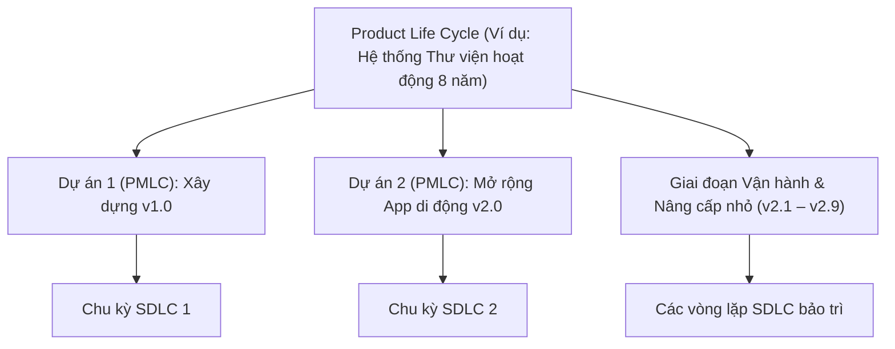

import QuickCheck from '../../../components/QuickCheck.astro';
import Quiz from '../../../components/Quiz.astro';
import ReflectBox from '../../../components/ReflectBox.astro';
import Term from '../../../components/Term.astro';

## Mục tiêu bài học (Thang Bloom)

Sau khi học xong bài này, bạn sẽ có khả năng:
- **Hiểu & Phân biệt** chính xác 3 khái niệm hay bị nhầm lẫn: **SDLC**, **PMLC** và **Product Life Cycle**.
- **Giải thích** được quy luật chi phí sửa lỗi tăng theo cấp số nhân (Cost of Change) và ý nghĩa của **Shift-Left**.
- **Phân biệt** rạch ròi giữa **Verification** (Xác minh) và **Validation** (Thẩm định) qua tình huống thực tế.
- **Nhận diện** vai trò của **Entry Criteria**, **Exit Criteria** và **Baseline** trong việc kiểm soát chất lượng giữa các giai đoạn.

---

## 1. SDLC là gì?

**<Term id="sdlc">SDLC (Software Development Life Cycle)</Term>** là khung quy trình có cấu trúc, mô tả toàn bộ các giai đoạn một hệ thống phần mềm trải qua — từ khi hình thành ý tưởng nghiệp vụ, phân tích yêu cầu, thiết kế, xây dựng, kiểm thử, triển khai, vận hành bảo trì cho đến khi chính thức ngừng sử dụng (decommissioning / retirement).

:::note[Đừng hiểu lầm!]
Sơ đồ 7 giai đoạn trên mô tả **những hoạt động logic nào cần có**, KHÔNG có nghĩa mọi dự án đều chạy một đường thẳng từ 1 đến 7. Cách tổ chức, lặp lại hay chồng lấn 7 giai đoạn này chính là **Mô hình SDLC** (sẽ học kỹ ở M1).
:::

### Vì sao không thể "cứ nghe ý tưởng rồi code luôn"?

Khi làm bài tập cá nhân nhỏ, việc "code thẳng" có thể tạm ổn. Nhưng với phần mềm phục vụ tổ chức (nhiều người dùng, nhiều lập trình viên, có ngân sách và ràng buộc dữ liệu), bỏ qua SDLC sẽ dẫn tới 4 hệ quả kinh điển:
1. **Hiểu sai nhu cầu:** Mỗi người hình dung một kiểu vì không có đặc tả và thống nhất chung.
2. **<Term id="scope-creep">Scope Creep</Term> (phình phạm vi):** Yêu cầu thêm mới liên tục chen vào mà không đánh giá tác động lên tiến độ và chi phí.
3. **Lỗi lan truyền không kiểm soát:** Sai từ thiết kế bị che giấu tới tận ngày ra mắt mới bùng phát.
4. **Không thể bảo trì:** Người viết code nghỉ việc là cả hệ thống thành "hộp đen", không có tài liệu, không có bộ test để sửa an toàn.

---

## 2. Phân biệt 3 vòng đời rất dễ nhầm: SDLC vs PMLC vs Product Life Cycle

Nhiều người mới đi làm đánh đồng "quy trình làm phần mềm" với "quản lý dự án". Hiểu đúng ranh giới giữa 3 vòng đời giúp bạn giao tiếp chuẩn xác với PM, PO và đội kỹ thuật:

| Tiêu chí | SDLC (Vòng đời phát triển phần mềm) | <Term id="pmlc">PMLC</Term> (Vòng đời quản lý dự án) | <Term id="product-lifecycle">Product Life Cycle</Term> (Vòng đời sản phẩm) |
|---|---|---|---|
| **Trọng tâm** | Cách **tạo ra và duy trì sản phẩm phần mềm** (kỹ thuật & nghiệp vụ) | Cách **quản lý dự án** (phạm vi, tiến độ, chi phí, nhân sự, rủi ro) | **Vòng đời thương mại** của sản phẩm trên thị trường / trong tổ chức |
| **Các bước điển hình** | Kế hoạch → Yêu cầu → Thiết kế → Code → Test → Triển khai → Vận hành | Khởi tạo → Lập kế hoạch → Thực thi → Giám sát & Kiểm soát → Đóng dự án | Ý tưởng → Ra mắt → Tăng trưởng → Bão hòa → Thoái trào → Ngừng cung cấp |
| **Người dẫn dắt chính** | BA, Tech Lead, Developers, QA, DevOps | Project Manager (PM) | Product Manager / Product Owner / Ban lãnh đạo |
| **Thời gian tồn tại** | Gắn với từng đợt phát triển hoặc bảo trì phần mềm | Có ngày bắt đầu và ngày kết thúc rõ ràng | Dài nhất — có thể kéo dài nhiều năm, chứa **nhiều PMLC và nhiều SDLC** |

<QuickCheck
  id="qc-m01-1"
  question="Một công ty đã ra mắt phần mềm Quản lý Thư viện v1.0 vào năm ngoái và đóng dự án v1.0. Năm nay họ mở dự án mới kéo dài 4 tháng để xây thêm cổng đặt sách trên điện thoại (v2.0). Phát biểu nào đúng?"
  options={[
    "Vòng đời sản phẩm (Product Life Cycle) đã kết thúc từ năm ngoái khi đóng dự án v1.0.",
    "Dự án v2.0 là một PMLC mới (và chu kỳ SDLC mới) nằm bên trong cùng một Product Life Cycle của sản phẩm Thư viện.",
    "PMLC không áp dụng cho phiên bản v2.0 vì phần mềm đã tồn tại.",
    "SDLC chỉ tồn tại ở giai đoạn v1.0, còn v2.0 chỉ là PMLC."
  ]}
  correctIndex={1}
  explanation="Một sản phẩm có thể trải qua nhiều dự án (PMLC) và nhiều chu kỳ phát triển (SDLC) trong suốt vòng đời thương mại của nó."
/>

---

## 3. Quy luật Chi phí thay đổi (Cost of Change) & Nguyên lý Shift-Left

Một trong những quy luật quan trọng nhất của kỹ thuật phần mềm (được ghi nhận xuyên suốt trong *Software Engineering* của Sommerville, *Software Requirements* của Wiegers và ISTQB CTFL) là **chi phí sửa một lỗi tăng theo cấp số nhân theo thời điểm phát hiện lỗi**:

| Giai đoạn phát hiện lỗi (xuất phát từ Yêu cầu) | Mức chi phí khắc phục tương đối | Lý do chi phí tăng vọt |
|---|---|---|
| Phân tích yêu cầu | **1x** | Chỉ cần sửa vài dòng trong tài liệu đặc tả hoặc User Story |
| Thiết kế | **3x – 6x** | Phải chỉnh lại sơ đồ kiến trúc, cơ sở dữ liệu, wireframe |
| Lập trình | **10x** | Phải sửa mã nguồn, cấu trúc DB, unit test và cập nhật tài liệu |
| Kiểm thử hệ thống / UAT | **15x – 40x** | Đã tích hợp nhiều module, phải chạy lại kiểm thử hồi quy, trễ mốc bàn giao |
| **Production (đang chạy thật)** | **30x – 100x+** | Phải phát hành bản vá khẩn, khắc phục dữ liệu hỏng, bồi thường hoặc mất uy tín người dùng |

Từ quy luật này sinh ra nguyên lý **<Term id="shift-left">Shift-Left</Term>** (dịch chuyển hoạt động kiểm tra sang bên trái trên trục thời gian): thay vì chờ code xong mới kiểm thử, ta chủ động rà soát yêu cầu, phản biện thiết kế và viết kịch bản kiểm thử ngay từ các giai đoạn đầu.

---

## 4. Verification vs Validation — Đừng bao giờ nhầm lẫn!

Đây là cặp khái niệm kinh điển xuất hiện trong gần như mọi đề thi ISTQB và phỏng vấn BA/QA:

- **Verification (Xác minh):** *"Are we building the product **right**?"* — Ta có đang xây sản phẩm **đúng theo đặc tả, thiết kế và chuẩn kỹ thuật** đã thống nhất không? (Ví dụ: rà soát SRS, code review, kiểm tra phần mềm chạy khớp công thức ghi trong đặc tả).
- **Validation (Thẩm định):** *"Are we building the **right** product?"* — Ta có đang xây **đúng sản phẩm giải quyết vấn đề thực tế của người dùng** không? (Ví dụ: cho người dùng thử prototype, kiểm thử chấp nhận người dùng UAT).

  

    
Ví dụ chuẩn: Đạt cả hai

    
Tài liệu đặc tả ghi rõ: "Trễ hạn từ ngày thứ 1 tính phạt 5.000đ/ngày, tối đa không quá giá bìa sách". Phần mềm chạy đúng công thức này (<strong>Verification đạt</strong>), và thủ thư kiểm thử UAT xác nhận công thức hoàn toàn khớp quy chế thư viện hiện hành (<strong>Validation đạt</strong>).

  

  

    
Cái bẫy hay gặp: Đạt Verification, Trượt Validation

    
BA viết nhầm trong đặc tả là "50.000đ/ngày". Lập trình viên code cực sạch đúng 50.000đ/ngày, QA kiểm thử khớp 100% đặc tả (<strong>Verification đạt</strong>). Đến UAT, thủ thư phản đối vì phạt quá cao so với quy chế (<strong>Validation trượt</strong>) → phải sửa lại từ đầu.

  

---

## 5. Cổng chất lượng: Entry Criteria, Exit Criteria & Baseline

Làm sao để lỗi của giai đoạn trước không trôi sang giai đoạn sau? SDLC dùng 3 cơ chế kiểm soát:

1. **<Term id="entry-exit-criteria">Entry Criteria</Term> (Tiêu chí đầu vào):** Điều kiện tối thiểu phải có trước khi mở một giai đoạn.
   - *Ví dụ cho giai đoạn Kiểm thử hệ thống:* Mã nguồn đã đóng gói trên môi trường Test, dữ liệu mẫu đã nạp xong, danh sách test case đã được rà soát.
2. **Exit Criteria (Tiêu chí đầu ra):** Điều kiện chất lượng bắt buộc phải thỏa mãn trước khi đóng giai đoạn.
   - *Ví dụ cho giai đoạn Phân tích yêu cầu:* 100% yêu cầu trọng yếu đã được rà soát, không còn mục "TBD" (chưa xác định), đại diện nghiệp vụ và kỹ thuật đã ký xác nhận.
3. **<Term id="baseline">Baseline</Term> (Đường cơ sở):** Phiên bản chính thức đã được duyệt ở cổng Exit (ví dụ `SRS v1.0`). Từ thời điểm chốt baseline, mọi thay đổi đều phải đi qua đánh giá ảnh hưởng và phê duyệt chính thức thay vì tự ý sửa ngầm.

<QuickCheck
  id="qc-m01-2"
  question="Nhóm phát triển đang gấp tiến độ nên bỏ qua bước rà soát và ký duyệt tài liệu đặc tả (Exit Criteria của giai đoạn Yêu cầu) để lập trình viên code sớm hơn 3 ngày. Rủi ro lớn nhất là gì?"
  options={[
    "Lập trình viên sẽ không có việc để làm.",
    "Các điểm mơ hồ hoặc hiểu nhầm yêu cầu bị đưa thẳng vào mã nguồn, dẫn tới sửa đi sửa lại ở giai đoạn kiểm thử với chi phí và thời gian lớn hơn nhiều so với 3 ngày tiết kiệm được.",
    "Không thể sử dụng Git để lưu mã nguồn.",
    "Không có rủi ro nào vì luôn có thể sửa code ở bước cuối."
  ]}
  correctIndex={1}
  explanation="Bỏ qua Exit Criteria làm tăng defect leakage (lỗi lọt sang giai đoạn sau). Theo quy luật Cost of Change, thời gian sửa lại ở cuối dự án thường gấp nhiều lần thời gian tiết kiệm ban đầu."
/>

---

## 6. Tự giải thích & Kiểm tra thành thạo

<ReflectBox
  lessonId="m0-1"
  prompt="Hãy giải thích bằng 3–4 câu cho một người mới vào nghề: (1) SDLC khác PMLC ở đâu, (2) Vì sao phát hiện lỗi sớm lại rẻ hơn nhiều, và (3) Verification khác Validation thế nào?"
  sampleKeyPoints={[
    "SDLC tập trung vào quy trình kỹ thuật tạo và duy trì sản phẩm phần mềm; PMLC tập trung vào quản lý phạm vi, tiến độ, chi phí và rủi ro dự án.",
    "Lỗi phát hiện càng muộn càng phải sửa dây chuyền cả đặc tả, thiết kế, mã nguồn, bộ test và dữ liệu thực tế nên chi phí tăng theo cấp số nhân (nguyên lý Shift-Left).",
    "Verification kiểm tra sản phẩm có đúng đặc tả không (building the product right); Validation kiểm tra sản phẩm có đúng nhu cầu thực tế của người dùng không (building the right product)."
  ]}
/>

<Quiz quizId="m0-1" />

---

## Nguồn tham khảo

- **Ian Sommerville**, *Software Engineering* (10th ed.), Chương 1 (Introduction) & Chương 2 (Software Processes).
- **IEEE Computer Society**, *SWEBOK Guide v4.0* (2024), Knowledge Area: Software Engineering Process & Software Quality.
- **ISTQB**, *Certified Tester Foundation Level (CTFL) Syllabus v4.0*, Chương 1 & Chương 2 (Shift-Left, Verification vs Validation, Entry/Exit Criteria).
- **Karl Wiegers & Joy Beatty**, *Software Requirements* (3rd ed.), Chương 1 (The Essential Software Requirement).
