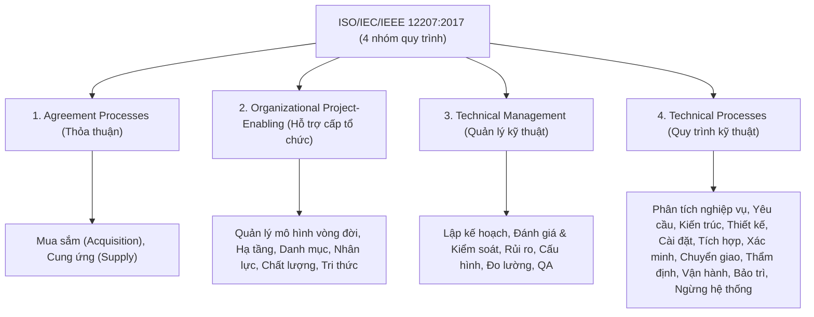

import QuickCheck from '../../../components/QuickCheck.astro';
import Quiz from '../../../components/Quiz.astro';
import ReflectBox from '../../../components/ReflectBox.astro';
import Term from '../../../components/Term.astro';

## Mục tiêu bài học (Thang Bloom)

Sau khi học xong bài này, bạn sẽ có khả năng:
- **Phân biệt** rạch ròi trách nhiệm của các vai trò cốt lõi: Stakeholder, Sponsor, PM, PO, BA, Architect/Dev, QA/QC, DevOps.
- **Phân biệt** chính xác **QA (Đảm bảo chất lượng)** và **QC (Kiểm soát chất lượng)**.
- **Thiết lập & Rà soát** một bảng **<Term id="raci">RACI Matrix</Term>** không mắc lỗi chồng chéo hoặc bỏ trống trách nhiệm.
- **Trình bày** được 4 nhóm quy trình của chuẩn quốc tế **ISO/IEC/IEEE 12207:2017** và hiểu vì sao chuẩn này không ép buộc một mô hình SDLC duy nhất.

---

## 1. Bản đồ các vai trò trong một dự án phần mềm

Một dự án phần mềm không phải chỉ có lập trình viên. Sự phối hợp trơn tru bắt đầu từ việc hiểu đúng mỗi vai trò chịu trách nhiệm cho câu hỏi nào:

| Vai trò | Câu hỏi cốt lõi họ trả lời | Đầu ra tiêu biểu |
|---|---|---|
| **<Term id="stakeholder">Stakeholder</Term> / Sponsor** | *Vì sao tổ chức cần đầu tư hệ thống này?* | Mục tiêu kinh doanh, ngân sách, phê duyệt cuối |
| **<Term id="pm">Project Manager (PM)</Term>** | *Làm sao giao đúng phạm vi, tiến độ, chi phí và kiểm soát rủi ro?* | Kế hoạch dự án, WBS, báo cáo tiến độ, quản lý rủi ro |
| **<Term id="po">Product Owner (PO)</Term>** | *Nên làm tính năng nào trước để tối đa hóa giá trị sản phẩm?* | Tầm nhìn sản phẩm, Product Backlog đã xếp ưu tiên |
| **<Term id="ba">Business Analyst (BA)</Term>** | *Nghiệp vụ cụ thể hoạt động ra sao và hệ thống cần đáp ứng yêu cầu nào?* | BRD, SRS, User Story + tiêu chí chấp nhận, BPMN, RTM |
| **<Term id="scrum-master">Scrum Master</Term>** | *Làm sao để đội vận hành đúng Scrum và gỡ bỏ trở ngại?* | Cải tiến quy trình, điều phối sự kiện, gỡ rào cản |
| **Solution Architect / Tech Lead** | *Hệ thống nên có kiến trúc và công nghệ ra sao để bền vững?* | Tài liệu kiến trúc (SAD), thiết kế API/DB, tiêu chuẩn kỹ thuật |
| **Developers (Lập trình viên)** | *Xây dựng chức năng sạch, an toàn và đúng thiết kế thế nào?* | Mã nguồn, Unit Test, bản build hoạt động |
| **QA / QC (Tester)** | *Quy trình đã đủ tốt chưa? Sản phẩm có lỗi hay thiếu sót nào không?* | Checklist chất lượng (QA), Test Plan, Test Case, Báo cáo lỗi (QC) |
| **DevOps / Ops Engineer** | *Làm sao triển khai tự động, an toàn và giữ hệ thống ổn định 24/7?* | Pipeline CI/CD, hạ tầng môi trường, giám sát & sao lưu |

### Hai cặp vai trò hay bị nhầm nhất ngoài thực tế

1. **Product Owner (PO) vs Business Analyst (BA):**
   - **PO** có quyền ra quyết định về *giá trị kinh doanh và thứ tự ưu tiên* (chọn làm tính năng A trước B).
   - **BA** chuyên sâu vào *kỹ thuật khơi gợi, phân tích, mô hình hóa luồng nghiệp vụ, xử lý ngoại lệ và đặc tả chi tiết* để đội kỹ thuật làm đúng.
   - *Thực tế:* Ở dự án nhỏ, một người có thể kiêm cả PO và BA; ở hệ thống nghiệp vụ phức tạp, PO giữ quyết định ưu tiên còn BA đi sâu vào phân tích chi tiết.

2. **<Term id="qa-qc">QA vs QC</Term>:**
   - **QA (Quality Assurance – Đảm bảo chất lượng):** Hướng **quy trình**, chủ động **phòng ngừa lỗi** (xây chuẩn rà soát tài liệu, quy định code review, kiểm tra tuân thủ quy trình).
   - **QC (Quality Control – Kiểm soát chất lượng):** Hướng **sản phẩm**, trực tiếp **phát hiện lỗi** trên phần mềm đã tạo ra (chạy test case, kiểm thử khám phá, kiểm thử hiệu năng).

  

    
Hiểu ĐÚNG về QA và QC

    
Chất lượng là trách nhiệm của cả nhóm. <strong>QA</strong> đặt ra quy định: "Mọi SRS phải qua checklist 10 điểm trước khi dev code". <strong>QC</strong> thực thi kiểm thử phần mềm để bắt lỗi thực tế trước khi bàn giao.

  

  

    
Hiểu SAI phổ biến

    
"QA là tên gọi sang hơn của Tester, chỉ việc ngồi bấm test lúc cuối và chịu trách nhiệm hoàn toàn nếu phần mềm có bug." → Cách hiểu này làm mất toàn bộ hoạt động phòng ngừa lỗi ở đầu vòng đời.

  

---

## 2. Ma trận RACI — Công cụ chống "cha chung không ai khóc"

Khi nhiều vai trò cùng tham gia một hoạt động SDLC, ta dùng **Ma trận RACI** để phân định rõ 4 mức độ tham gia:

- **R — Responsible (Người thực hiện):** Người trực tiếp làm công việc. Có thể có 1 hoặc nhiều người R.
- **A — Accountable (Người chịu trách nhiệm cuối & phê duyệt):** Người chịu trách nhiệm giải trình cuối cùng và có quyền ký duyệt. **BẮT BUỘC CHỈ CÓ DUY NHẤT 1 NGƯỜI A** trên mỗi dòng công việc.
- **C — Consulted (Người được tham vấn):** Chuyên gia cần hỏi ý kiến trước khi chốt (giao tiếp **hai chiều**).
- **I — Informed (Người được thông báo):** Người cần biết kết quả sau khi hoàn thành (giao tiếp **một chiều**).

### Ví dụ bảng RACI chuẩn cho giai đoạn Phân tích & Kiểm thử

| Đầu việc / Sản phẩm | Sponsor / PO | PM | BA | Tech Lead | QA/QC |
|---|---|---|---|---|---|
| Lập đặc tả yêu cầu (SRS) | **A** | I | **R** | C | C |
| Lập kế hoạch tiến độ & rủi ro | I | **A / R** | C | C | C |
| Thiết kế kiến trúc hệ thống | I | I | C | **A / R** | I |
| Lập Test Plan & Kịch bản kiểm thử | I | I | C | C | **A / R** |
| Ký nghiệm thu UAT | **A / R** | I | C | I | C |

*(Lưu ý: Một người có thể vừa là A vừa là R khi họ vừa trực tiếp làm vừa chịu trách nhiệm phê duyệt cuối cùng cho công việc trong phạm vi thẩm quyền của mình.)*

<QuickCheck
  id="qc-m02-1"
  question="Khi rà soát một bảng RACI của dự án, dấu hiệu nào dưới đây báo hiệu LỖI THIẾT KẾ NGHIÊM TRỌNG cần sửa ngay?"
  options={[
    "Có 2 lập trình viên cùng giữ vai trò R cho công việc viết mã nguồn.",
    "Có 3 bên liên quan cùng giữ vai trò I cho thông báo phát hành.",
    "Dòng công việc 'Phê duyệt thay đổi phạm vi' có 2 người cùng giữ vai trò A (vừa PO vừa PM).",
    "Một công việc có BA là R và Tech Lead là C."
  ]}
  correctIndex={2}
  explanation="Quy tắc bất biến của RACI: mỗi dòng công việc phải có ĐÚNG 1 chữ A (Accountable). Nếu có 2 chữ A sẽ dẫn đến xung đột quyết định hoặc đùn đẩy trách nhiệm khi có sự cố."
/>

---

## 3. Khung chuẩn quốc tế ISO/IEC/IEEE 12207:2017

Nếu hỏi "Chuẩn quốc tế gốc nào định nghĩa đầy đủ nhất về SDLC?", câu trả lời chính là **ISO/IEC/IEEE 12207:2017** (*Systems and software engineering — Software life cycle processes*).

Thay vì liệt kê cứng nhắc 7 bước tuần tự, ISO 12207 tổ chức **30 quy trình vòng đời phần mềm** thành **4 nhóm lớn** để áp dụng được cho mọi mô hình (Waterfall, V-Model, Agile hay DevOps):

### 3 điểm cốt lõi cần nhớ về ISO/IEC/IEEE 12207:2017

1. **Trung lập về mô hình (Model-agnostic):** Chuẩn nói *cần có những quy trình nào* (WHAT), không ép buộc *làm theo thứ tự nào* (HOW). Doanh nghiệp thực hiện bước **Tailoring (tinh chỉnh)** để khớp với Waterfall hay Scrum.
2. **Bao trùm tới tận "Ngừng hệ thống" (Disposal / Retirement):** Nhiều tài liệu trên mạng quên mất giai đoạn cuối cùng — lưu trữ dữ liệu tuân thủ pháp lý, hủy khóa bảo mật và ngắt hệ thống cũ an toàn.
3. **Tách rõ Quản lý kỹ thuật và Quy trình kỹ thuật:** Các hoạt động như Quản lý rủi ro, Quản lý cấu hình, QA chạy *xuyên suốt* vòng đời chứ không phải một bước làm một lần rồi thôi.

---

## 4. Tự giải thích & Kiểm tra thành thạo

<ReflectBox
  lessonId="m0-2"
  prompt="Hãy giải thích bằng 3–4 câu: (1) QA khác QC thế nào, (2) Quy tắc quan trọng nhất khi lập bảng RACI là gì, và (3) Vì sao ISO 12207 áp dụng được cho cả Waterfall lẫn Agile?"
  sampleKeyPoints={[
    "QA hướng quy trình để phòng ngừa lỗi ngay từ đầu; QC hướng sản phẩm để kiểm thử và phát hiện lỗi trên sản phẩm đã tạo ra.",
    "Trong RACI, mỗi đầu việc phải có ít nhất 1 R và BẮT BUỘC chỉ có duy nhất 1 A (Accountable); C là tham vấn 2 chiều còn I là thông báo 1 chiều.",
    "ISO/IEC/IEEE 12207:2017 chỉ định nghĩa 4 nhóm quy trình cần có (WHAT) chứ không áp đặt thứ tự thực thi, cho phép tổ chức tinh chỉnh (tailoring) theo mọi mô hình SDLC."
  ]}
/>

<Quiz quizId="m0-2" />

---

## Nguồn tham khảo

- **ISO/IEC/IEEE 12207:2017**, *Systems and software engineering — Software life cycle processes* (Clause 6: Software life cycle processes).
- **IIBA**, *BABOK Guide v3*, Chương 2 (Business Analysis Key Concepts) & Kỹ thuật Roles and Permissions Matrix (RACI).
- **ISTQB**, *CTFL Syllabus v4.0*, Chương 1 (Section 1.2.2: Testing and Quality Assurance).
- **Ken Schwaber & Jeff Sutherland**, *The Scrum Guide (2020)* (Scrum Team Accountabilities).
