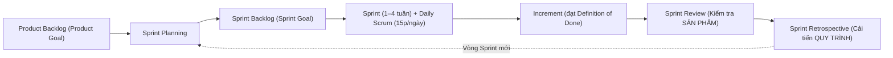

import QuickCheck from '../../../components/QuickCheck.astro';
import Quiz from '../../../components/Quiz.astro';
import ReflectBox from '../../../components/ReflectBox.astro';
import Term from '../../../components/Term.astro';

## Mục tiêu bài học (Thang Bloom)

Sau khi học xong bài này, bạn sẽ có khả năng:
- **Giải thích đúng** 4 giá trị của **Tuyên ngôn Agile (2001)** và bác bỏ các hiểu lầm phổ biến ("Agile không viết tài liệu", "Agile không lập kế hoạch").
- **Trình bày chính xác** cấu trúc **Scrum Guide 2020**: 3 trách nhiệm, 5 sự kiện, 3 artifact cùng 3 cam kết đi kèm.
- **So sánh** rõ **Scrum**, **Kanban**, **XP** và hiểu cách **DevOps** mở rộng Agile sang vận hành.
- **Nhận diện** sự khác biệt giữa **Hybrid thực thụ** và phản mẫu **Water-Scrum-Fall**.

---

## 1. Agile là tư duy (Mindset), không phải một quy trình đơn lẻ

Năm 2001, 17 chuyên gia phần mềm công bố **Tuyên ngôn Agile (<Term id="agile">Agile Manifesto</Term>)** gồm **4 giá trị** và **12 nguyên tắc**:

| Ưu tiên cao hơn (Vế trái) | Hơn là (Vế phải — vẫn có giá trị!) |
|---|---|
| **Cá nhân và sự tương tác** | Quy trình và công cụ |
| **Phần mềm chạy được** | Tài liệu đầy đủ, đồ sộ |
| **Cộng tác với khách hàng** | Đàm phán hợp đồng cứng nhắc |
| **Phản hồi với thay đổi** | Bám sát một kế hoạch cố định |

  

    
Hiểu ĐÚNG về Agile

    
Agile có kỷ luật rất cao: vẫn lập kế hoạch (theo Sprint & Release), vẫn viết tài liệu <em>vừa đủ dùng</em> (User Story, tiêu chí chấp nhận, sơ đồ kiến trúc sống), và giữ chất lượng kỹ thuật nghiêm ngặt qua Definition of Done.

  

  

    
Hiểu SAI nguy hiểm ("Fake Agile")

    
"Đội mình làm Agile nên không cần viết đặc tả, không cần ước lượng, khách thích đổi gì giữa Sprint cũng nhét vào luôn, chạy được là xong!" → Đây là làm việc hỗn loạn (Ad-hoc), không phải Agile.

  

---

## 2. Scrum (theo Scrum Guide 2020)

**<Term id="scrum">Scrum</Term>** là khung làm việc phổ biến nhất dưới chiếc ô Agile, vận hành theo chủ nghĩa kinh nghiệm (Empiricism) với 3 trụ cột: **Minh bạch (Transparency) – Thanh tra (Inspection) – Thích nghi (Adaptation)**.

### Tóm tắt "3 – 5 – 3" bắt buộc phải thuộc lòng (Scrum Guide 2020)

| Nhóm | Thành phần | Điểm chốt dễ bị hỏi trong bài thi |
|---|---|---|
| **3 Trách nhiệm** | **Product Owner**, **Scrum Master**, **Developers** | PO là **1 người duy nhất** (không phải ủy ban). Scrum Team không chia phân cấp sếp – lính, quy mô lý tưởng ≤ 10 người |
| **5 Sự kiện** | **Sprint** (chứa 4 sự kiện con): **Sprint Planning**, **Daily Scrum**, **Sprint Review**, **Sprint Retrospective** | Sprint cố định thời gian (time-boxed ≤ 1 tháng), **không kéo dài** để cố làm cho xong. Daily Scrum (15 phút) là buổi lập kế hoạch cho **Developers**, không phải báo cáo cho quản lý |
| **3 Artifact (+ 3 Cam kết)** | **Product Backlog** (*Product Goal*) · **Sprint Backlog** (*Sprint Goal*) · **Increment** (*<Term id="dod">Definition of Done</Term>*) | Mọi hạng mục chưa đạt **DoD** ở cuối Sprint **không** được tính vào Increment mà trả lại Product Backlog |

<QuickCheck
  id="qc-m12-1"
  question="Vào ngày cuối của Sprint 2 tuần, một tính năng đã lập trình xong nhưng chưa kịp kiểm thử tích hợp theo quy định trong Definition of Done (DoD). Đội Scrum nên xử lý thế nào theo Scrum Guide 2020?"
  options={[
    "Gia hạn Sprint thêm 3 ngày để kiểm thử xong rồi mới đóng Sprint.",
    "Vẫn trình diễn và đánh dấu là hoàn thành 90% trong Increment.",
    "Đóng Sprint đúng hạn; tính năng chưa đạt DoD không được tính là hoàn thành và quay lại Product Backlog để Product Owner quyết định ưu tiên tiếp.",
    "Bỏ qua bước kiểm thử để kịp ra mắt."
  ]}
  correctIndex={2}
  explanation="Sprint luôn cố định khung thời gian (time-boxed) và không có khái niệm 'hoàn thành 90%'. Nếu chưa đạt Definition of Done thì chưa tạo ra Increment hoàn chỉnh."
/>

---

## 3. Kanban & Extreme Programming (XP)

### a) <Term id="kanban">Kanban</Term> — Tối ưu luồng công việc liên tục
Khác với Scrum (đóng gói việc vào từng Sprint cố định), Kanban quản lý dòng chảy liên tục dựa trên **4 nguyên tắc cốt lõi**:
1. **Trực quan hóa luồng công việc** trên bảng (Backlog → Phân tích → Đang làm → Kiểm thử → Hoàn thành).
2. **Giới hạn công việc đang dở dang (<Term id="wip-limit">WIP Limit</Term>):** Ví dụ cột "Đang kiểm thử" tối đa 3 thẻ. Khi đã đầy, cả nhóm ngừng kéo thêm việc mới mà tập trung hỗ trợ gỡ nút thắt cổ chai (*"Stop starting, start finishing"*).
3. **Quản lý và đo lường dòng chảy:** Theo dõi **Lead Time** (từ lúc nhận yêu cầu đến lúc giao), **Cycle Time** (từ lúc bắt đầu làm đến lúc xong) và **Throughput** (số việc xong mỗi tuần).
4. **Cải tiến liên tục** dựa trên dữ liệu luồng.

- **Phù hợp nhất khi:** Công việc đến bất ngờ liên tục (đội vận hành, bảo trì, xử lý sự cố, đội hỗ trợ nhiều phòng ban).

### b) <Term id="xp">Extreme Programming (XP)</Term> — Kỷ luật kỹ thuật xuất sắc
Nếu Scrum nói về *cách phối hợp quản trị*, XP đi sâu vào *kỷ luật kỹ thuật* để mã nguồn luôn sạch và sẵn sàng thay đổi:
- **TDD (Test-Driven Development):** Viết bài test thất bại trước → viết code tối thiểu để pass → tối ưu code.
- **Pair Programming:** Hai lập trình viên cùng ngồi giải quyết bài toán khó (một người gõ, một người rà soát tư duy liên tục).
- **Continuous Integration (CI)** & **Refactoring liên tục** để giữ <Term id="technical-debt">nợ kỹ thuật</Term> luôn thấp.

---

## 4. DevOps & Mô hình Hybrid (Lai)

### a) <Term id="devops">DevOps</Term> — Nối liền Phát triển và Vận hành
Trong SDLC cũ, đội **Dev** muốn đẩy tính năng mới thật nhanh còn đội **Ops** muốn hạn chế thay đổi để hệ thống không sập — tạo ra xung đột kinh điển. DevOps phá bỏ bức tường này bằng:
- Văn hóa chia sẻ trách nhiệm chung từ lúc viết code đến khi chạy trên Production.
- Tự động hóa quy trình build, kiểm thử và triển khai (**CI/CD pipeline**).
- Giám sát hệ thống thời gian thực và phản hồi sự cố nhanh (đo bằng 4 chỉ số DORA sẽ học sâu ở Cấp 3).

### b) <Term id="hybrid-sdlc">Hybrid SDLC (Mô hình Lai)</Term>
Rất nhiều tổ chức thực tế không thể chạy 100% Waterfall cũng không thể chạy 100% Agile thuần. **Hybrid** kết hợp có chủ đích hai thế giới:
- **Tầng quản trị & khung kiến trúc (Dự đoán / Waterfall):** Chốt Business Case, ngân sách trần, mốc bàn giao lớn, kiến trúc nền tảng và quy chuẩn tuân thủ.
- **Tầng thực thi tính năng (Thích nghi / Agile):** Chia thành các Sprint 2 tuần để phát triển, demo sớm, nhận phản hồi và kiểm thử tích hợp liên tục.

:::caution[Tránh bẫy "Water-Scrum-Fall"]
Đừng nhầm Hybrid thực thụ với **Water-Scrum-Fall** — khi đội chỉ đổi tên cuộc họp sang "Sprint/Daily" nhưng vẫn viết 100% đặc tả cứng từ đầu rồi dồn toàn bộ kiểm thử và tích hợp sang tháng cuối cùng trước ngày go-live.
:::

---

## 5. So sánh nhanh Scrum vs Kanban vs Hybrid

| Tiêu chí | Scrum | Kanban | Hybrid |
|---|---|---|---|
| **Nhịp làm việc** | Theo Sprint cố định (1–4 tuần) | Luồng liên tục, không có Sprint | Mốc lớn cố định + Sprint bên trong |
| **Thay đổi giữa chừng** | Bảo vệ Sprint Goal, đưa đổi mới vào Backlog | Chấp nhận đổi ưu tiên bất cứ lúc nào (miễn không vượt WIP) | Kiểm soát chặt phạm vi mốc lớn, linh hoạt chi tiết trong Sprint |
| **Vai trò bắt buộc** | PO, Scrum Master, Developers | Không bắt buộc vai trò mới | Thường có PM + BA/PO + Dev + QA |
| **Chỉ số đặc trưng** | Sprint Goal đạt được, Velocity, Burndown | WIP, Lead Time, Cycle Time | Tiến độ mốc (Milestone) + chất lượng từng Increment |

---

## 6. Tự giải thích & Kiểm tra thành thạo

<ReflectBox
  lessonId="m1-2"
  prompt="Hãy giải thích bằng 3–4 câu: (1) Hiểu đúng về tài liệu trong Agile là gì, (2) Sprint Review khác Sprint Retrospective ở đâu, và (3) Khi nào nên chọn Kanban thay vì Scrum?"
  sampleKeyPoints={[
    "Agile không cấm viết tài liệu mà ưu tiên tài liệu vừa đủ mang lại giá trị (just enough) phục vụ phần mềm chạy được thay vì tài liệu cồng kềnh không ai đọc.",
    "Sprint Review tập trung kiểm tra SẢN PHẨM (Increment) cùng các bên liên quan; Sprint Retrospective tập trung kiểm tra QUY TRÌNH & cách phối hợp nội bộ để cải tiến Sprint sau.",
    "Chọn Kanban khi công việc phát sinh liên tục, ưu tiên thay đổi từng ngày (như vận hành, sửa lỗi, hỗ trợ) và cần kiểm soát tắc nghẽn bằng WIP Limit thay vì đóng khung Sprint cố định."
  ]}
/>

<Quiz quizId="m1-2" />

---

## Nguồn tham khảo

- **Manifesto for Agile Software Development (2001)** — 4 giá trị & 12 nguyên tắc (agilemanifesto.org).
- **Ken Schwaber & Jeff Sutherland**, *The Scrum Guide* (Phiên bản 11/2020 — bản chính thức hiện hành).
- **Ian Sommerville**, *Software Engineering* (10th ed.), Chương 3 (Agile Software Development).
- **IEEE Computer Society**, *SWEBOK Guide v4.0* (2024), Software Engineering Process & Software Engineering Operations (DevOps).
