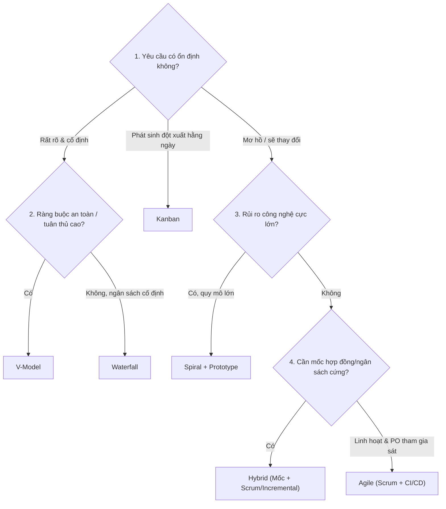

import ModelAdvisor from '../../../components/ModelAdvisor.astro';
import Quiz from '../../../components/Quiz.astro';
import ReflectBox from '../../../components/ReflectBox.astro';

## Mục tiêu bài học (Thang Bloom)

Sau khi học xong bài này, bạn sẽ có khả năng:
- **Áp dụng** khung **5 tiêu chí** để phân tích đặc thù của bất kỳ dự án phần mềm nào.
- **Lựa chọn & Bảo vệ** được lý do chọn mô hình SDLC (Waterfall, V-Model, Incremental, Spiral, Prototyping, Scrum, Kanban, Hybrid) trước các bên liên quan.
- **Chỉ ra** rủi ro đi kèm của mô hình mình chọn và biện pháp phòng ngừa tương ứng.

---

## 1. Khung 5 tiêu chí quyết định chọn mô hình SDLC

Nguyên tắc vàng của kỹ thuật phần mềm (SWEBOK v4 & ISTQB CTFL v4.0): **Không có mô hình nào tốt nhất cho mọi dự án.** Trước khi chọn mô hình, hãy trả lời 5 câu hỏi sau:

| # | Tiêu chí phân tích | Nghiêng về Dự đoán (Waterfall / V-Model) | Nghiêng về Thích nghi (Scrum / Kanban / Hybrid) |
|---|---|---|---|
| 1 | **Độ rõ & ổn định yêu cầu** | Đã chốt rõ 90–100%, ít biến động | Chưa rõ hết, cần học từ phản hồi người dùng |
| 2 | **Rủi ro công nghệ & an toàn** | Công nghệ quen thuộc hoặc quy chuẩn an toàn cứng | Công nghệ mới (cân nhắc Spiral) hoặc rủi ro thị trường cao |
| 3 | **Ràng buộc hợp đồng / pháp lý** | Hợp đồng trọn gói, bắt buộc ký hồ sơ từng cổng | Ngân sách theo giai đoạn / tối ưu giá trị kinh doanh |
| 4 | **Mức tham gia của khách hàng** | Thấp — chỉ họp lúc đầu và lúc UAT cuối | Cao — có PO/đại diện nghiệp vụ phản hồi mỗi 1–2 tuần |
| 5 | **Áp lực ra mắt sớm (Time-to-market)** | Thấp — ưu tiên bàn giao trọn gói một lần | Cao — cần tung bản lõi sớm để dùng thật và mở rộng dần |

---

## 2. Công cụ tương tác: Thử nghiệm chọn mô hình

Hãy thử thay đổi các tổ hợp thuộc tính bên dưới để quan sát cách khuyến nghị mô hình thay đổi theo bối cảnh dự án — đặc biệt hãy đọc kỹ phần **Bẫy cần tránh** của từng mô hình!

<ModelAdvisor />

---

## 3. Ba sai lầm kinh điển khi chọn mô hình SDLC

1. **Chọn theo phong trào ("Ai cũng làm Scrum nên mình cũng làm Scrum"):** Áp Scrum vào nhóm trực vận hành xử lý sự cố hằng ngày sẽ khiến Sprint liên tục vỡ kế hoạch; áp Scrum vào dự án mà khách hàng 3 tháng mới họp 1 lần thì không ai review Increment.
2. **Nhầm lẫn "chọn mô hình" với "bỏ qua kỷ luật kỹ thuật":** Dù chọn Waterfall hay Agile, bạn vẫn cần quản lý yêu cầu rõ ràng, rà soát thiết kế, kiểm thử nghiêm túc và quản lý thay đổi minh bạch.
3. **Không tinh chỉnh (Tailoring):** Mô hình trong sách là khung chuẩn; trong thực tế luôn cần điều chỉnh độ dài Sprint, mức độ chi tiết tài liệu và cổng rà soát sao cho phù hợp quy mô nhóm.

---

## 4. Tự giải thích & Kiểm tra tình huống

<ReflectBox
  lessonId="m1-3"
  prompt="Giả sử sếp hỏi bạn: 'Tại sao dự án này không làm Agile 100% cho hiện đại, hoặc không làm Waterfall cho dễ quản lý?'. Hãy viết 3–4 câu trả lời dựa trên khung 5 tiêu chí bạn vừa học."
  sampleKeyPoints={[
    "Không có mô hình nào tối ưu cho mọi dự án; lựa chọn phải căn cứ vào 5 tiêu chí: độ ổn định yêu cầu, mức độ rủi ro/tuân thủ, ràng buộc hợp đồng, mức độ tham gia của khách hàng và áp lực ra mắt sớm.",
    "Waterfall/V-Model mạnh khi yêu cầu cố định và cần hồ sơ tuân thủ chặt, nhưng rủi ro lớn nếu yêu cầu còn thay đổi.",
    "Agile/Scrum mạnh khi yêu cầu tiến hóa và khách hàng đồng hành sát sao; khi cần cả mốc ngân sách rõ ràng lẫn phản hồi sớm thì Hybrid là phương án cân bằng."
  ]}
/>

<Quiz quizId="m1-3" />

---

## Nguồn tham khảo

- **ISTQB**, *CTFL Syllabus v4.0*, Chương 2 (Section 2.1.1: Impact of the SDLC on Testing).
- **PMI**, *PMBOK Guide – Eighth Edition* (Development Approach and Life Cycle Performance Domain – Selecting a Development Approach).
- **IEEE Computer Society**, *SWEBOK Guide v4.0* (2024), Software Life Cycle Models.
