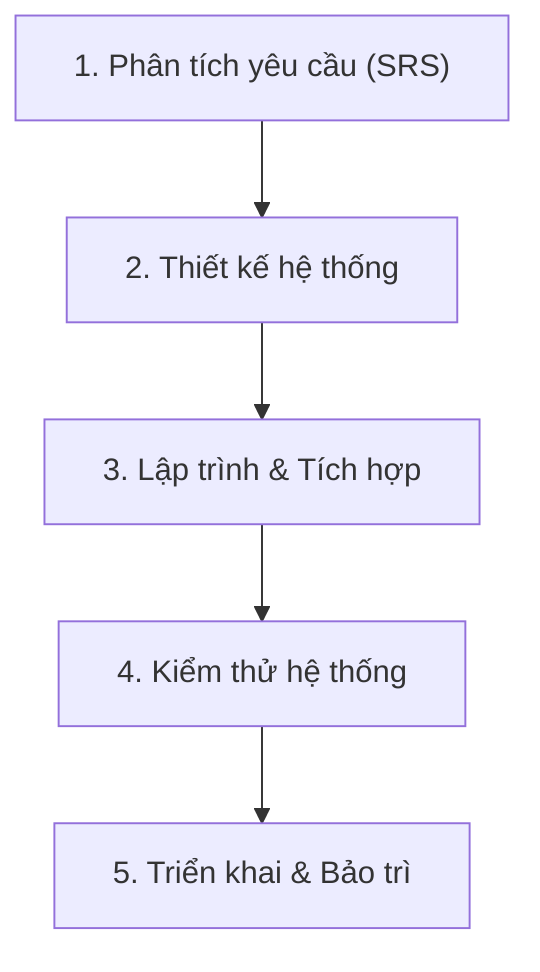
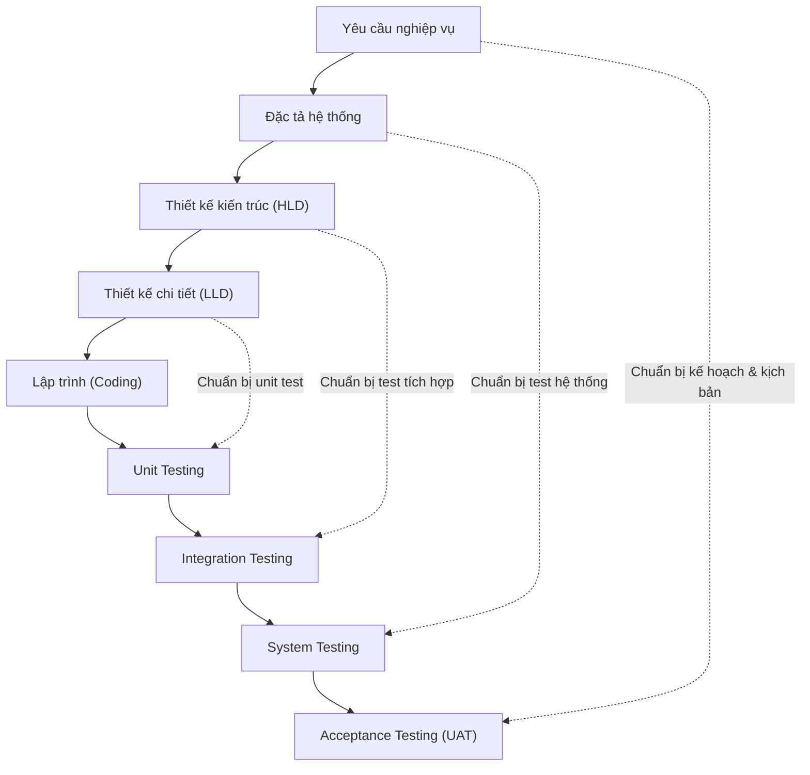
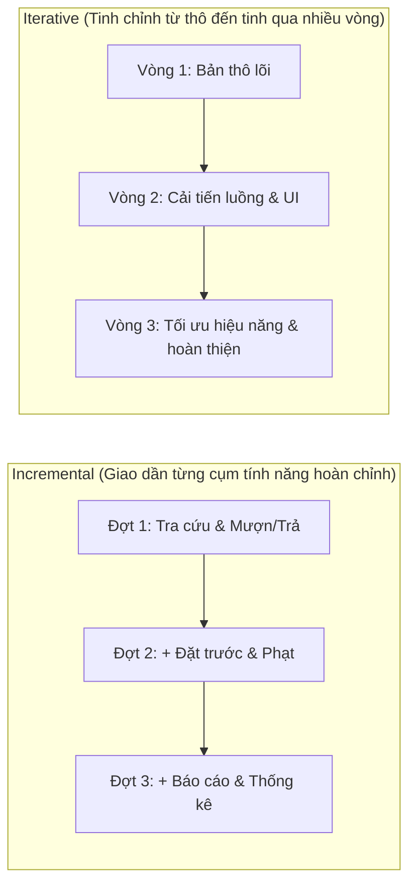
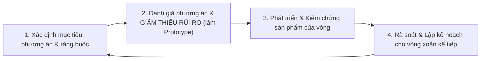

import QuickCheck from '../../../components/QuickCheck.astro';
import Quiz from '../../../components/Quiz.astro';
import ReflectBox from '../../../components/ReflectBox.astro';
import Term from '../../../components/Term.astro';

## Mục tiêu bài học (Thang Bloom)

Sau khi học xong bài này, bạn sẽ có khả năng:
- **Mô tả** đúng cơ chế vận hành của 6 mô hình: **Waterfall**, **V-Model**, **Incremental**, **Iterative**, **Spiral** và **Prototyping**.
- **Ghép cặp chính xác** các giai đoạn nhánh trái và cấp độ kiểm thử nhánh phải trong **V-Model**.
- **Phân biệt** rõ bản chất giữa **Incremental (Gia tăng)** và **Iterative (Lặp)**, cũng như **Throwaway** và **Evolutionary Prototyping**.
- **Phân tích** ưu/nhược điểm và lý do một mô hình thành công hay thất bại trong bối cảnh dự án cụ thể.

---

## 1. Mô hình Waterfall (Thác nước)

**<Term id="waterfall">Waterfall</Term>** là mô hình tuần tự (sequential): mỗi giai đoạn phải hoàn thành trọn vẹn, tạo đầy đủ tài liệu và được phê duyệt (Phase Gate) rồi mới chuyển xuống giai đoạn tiếp theo.

- **Điểm mạnh:** Dễ quản trị tiến độ và ngân sách theo mốc; hồ sơ tài liệu đầy đủ, minh bạch; dễ phân công nhân sự chuyên môn hóa từng khâu.
- **Điểm yếu:** Phần mềm chạy được xuất hiện rất muộn (gần cuối dự án); cực kỳ tốn kém nếu yêu cầu thay đổi giữa chừng; rủi ro hiểu sai yêu cầu bị tích tụ đến cuối mới phát hiện.
- **Khi nên dùng:** Yêu cầu đã rất rõ ràng và ổn định, công nghệ quen thuộc, dự án ràng buộc hợp đồng/pháp lý cứng yêu cầu hồ sơ phê duyệt theo từng giai đoạn.

---

## 2. Mô hình V-Model (Verification & Validation)

**<Term id="v-model">V-Model</Term>** phát triển từ Waterfall bằng cách biến trục thẳng thành chữ **V**: nhánh trái là các giai đoạn **đặc tả & thiết kế**, đáy chữ V là **lập trình**, nhánh phải là các **cấp độ kiểm thử tương ứng trực tiếp**.

### Bảng ánh xạ bắt buộc phải nhớ trong V-Model

| Nhánh trái (Thiết kế / Đặc tả) | Nhánh phải (Cấp kiểm thử tương ứng) | Trọng tâm kiểm tra |
|---|---|---|
| Yêu cầu nghiệp vụ / người dùng | **Acceptance Testing (UAT)** | Hệ thống có đáp ứng đúng nhu cầu nghiệp vụ? |
| Đặc tả yêu cầu hệ thống (SRS) | **System Testing** | Toàn hệ thống có chạy đúng chức năng & phi chức năng? |
| Thiết kế kiến trúc / tổng thể (HLD) | **Integration Testing** | Các module và giao diện tích hợp có nối với nhau đúng không? |
| Thiết kế chi tiết (LLD) | **Component / Unit Testing** | Từng hàm, lớp, thành phần độc lập có chạy đúng logic không? |

- **Khắc phục được gì so với Waterfall?** Áp dụng **Shift-Left**: ngay khi viết SRS xong là đội QA đã lập kế hoạch và thiết kế test case song song, giúp phát hiện mâu thuẫn trong tài liệu trước khi viết code.
- **Vẫn giữ hạn chế nào của Waterfall?** Vẫn tuần tự cứng, phản hồi từ phần mềm chạy thật đến muộn và tốn kém khi yêu cầu thay đổi lớn.
- **Khi nên dùng:** Hệ thống yêu cầu độ tin cậy/an toàn cực cao (thiết bị y tế, hàng không, ngân hàng lõi có quy chuẩn cứng) cần bằng chứng truy vết chặt ở từng cấp kiểm thử.

<QuickCheck
  id="qc-m11-1"
  question="Trong V-Model chuẩn, tài liệu 'Thiết kế kiến trúc / tổng thể (High-Level Design)' ở nhánh trái ánh xạ trực tiếp tới cấp kiểm thử nào ở nhánh phải?"
  options={[
    "Unit / Component Testing",
    "Integration Testing",
    "System Testing",
    "User Acceptance Testing (UAT)"
  ]}
  correctIndex={1}
  explanation="Thiết kế kiến trúc mô tả cấu trúc các module và giao diện tương tác giữa chúng → tương ứng trực tiếp với Integration Testing (Kiểm thử tích hợp)."
/>

---

## 3. Phân biệt Incremental (Gia tăng) và Iterative (Lặp)

Đây là hai khái niệm hay bị dùng lẫn lộn nhất trong sách báo. Hãy nhớ bằng hình ảnh **vẽ một bức chân dung**:

- **<Term id="incremental">Incremental (Gia tăng)</Term>:** Chia sản phẩm thành các **phần chức năng hoàn chỉnh** (Increment 1, 2, 3...) rồi bàn giao dần. Giống như vẽ hoàn thiện khuôn mặt trước → rồi vẽ phần thân → rồi vẽ nền. Mỗi đợt ra mắt người dùng đã dùng ngay được các tính năng lõi.
- **<Term id="iterative">Iterative (Lặp)</Term>:** Xây dựng một phiên bản **sơ bộ** rồi **tinh chỉnh nâng chất lượng** qua nhiều vòng dựa trên phản hồi. Giống như phác thảo nét chì toàn bức tranh → tô mảng màu cơ bản → vẽ chi tiết ánh sáng và sắc thái.

:::tip[Thực tế hiện đại]
Trong thực tế, hầu hết các dự án hiện đại (bao gồm Scrum) **kết hợp cả hai (Iterative & Incremental)**: mỗi đợt vừa giao thêm tính năng mới hoàn chỉnh, vừa tinh chỉnh các phần đã có dựa trên phản hồi người dùng.
:::

---

## 4. Mô hình Spiral (Xoắn ốc — Hướng rủi ro)

Do **Barry Boehm** đề xuất năm 1988, **<Term id="spiral">Spiral Model</Term>** đặt **phân tích và quản trị rủi ro (Risk-driven)** làm trung tâm. Mỗi vòng xoắn từ trong ra ngoài (chi phí tăng dần theo bán kính) đều đi qua đúng **4 góc phần tư**:

- **Điểm mạnh:** Cực tốt trong việc phát hiện và triệt tiêu sớm các rủi ro lớn (công nghệ mới, hiệu năng, bảo mật, pháp lý) trước khi đổ toàn bộ ngân sách.
- **Điểm yếu:** Quy trình đánh giá rủi ro phức tạp, tốn chi phí quản trị và đòi hỏi chuyên gia phân tích rủi ro giàu kinh nghiệm → **không phù hợp cho dự án nhỏ, ngân sách thấp**.
- **Khi nên dùng:** Hệ thống quy mô lớn, đắt đỏ, có độ bất định cao về công nghệ hoặc nghiệp vụ mới hoàn toàn.

---

## 5. Mô hình Prototyping (Nguyên mẫu)

**<Term id="prototyping">Prototyping</Term>** tạo nhanh một phiên bản mẫu để người dùng thao tác sớm nhằm làm rõ những yêu cầu còn mơ hồ ("nhìn thấy mới biết mình thực sự muốn gì"). Có **2 loại** hoàn toàn khác nhau về kỷ luật kỹ thuật:

| Loại nguyên mẫu | Cách làm | Rủi ro lớn nhất |
|---|---|---|
| **Throwaway Prototyping** (Nguyên mẫu bỏ đi) | Làm thật nhanh (wireframe tương tác, code tạm) chỉ để thống nhất yêu cầu, sau đó **vứt bỏ** và xây hệ thống thật sạch từ đầu | Khách hàng thấy bản mẫu chạy được liền ép "đưa luôn lên chạy thật", mang theo mã chắp vá và nợ kỹ thuật |
| **Evolutionary Prototyping** (Nguyên mẫu tiến hóa) | Xây bản mẫu trên nền kiến trúc tốt, rồi tinh chỉnh và mở rộng dần thành hệ thống Production | Nếu yêu cầu ban đầu đổi hướng hoàn toàn, chi phí đập đi làm lại cao hơn bản mẫu bỏ đi |

  

    
Cách dùng Prototyping ĐÚNG

    
Thống nhất trước với khách hàng bằng văn bản: "Bản mẫu tuần 1 làm bằng giao diện tĩnh/dữ liệu giả chỉ để chốt màn hình và luồng thao tác, không có bảo mật hay cơ sở dữ liệu thật — sau khi chốt sẽ xây dựng kiến trúc chuẩn."

  

  

    
Cái bẫy Prototyping SAI

    
Code vội một bản demo không kiểm thử, không phân quyền, rồi khi sếp khen đẹp thì vá chằng vá đụp thêm tính năng lên chính đống code đó để chạy chính thức.

  

---

## 6. Bảng tổng hợp nhanh 6 mô hình

| Mô hình | Độ ổn định yêu cầu cần thiết | Rủi ro xử lý tốt nhất | Phản hồi người dùng | Chi phí quản trị |
|---|---|---|---|---|
| **Waterfall** | Rất cao | Quản lý phạm vi/hợp đồng rõ | Rất muộn | Trung bình |
| **V-Model** | Rất cao | Sai sót tuân thủ & thiếu kiểm thử | Muộn (nhưng test sớm) | Trung bình – Cao |
| **Incremental** | Trung bình – Cao (lõi rõ) | Áp lực giao giá trị sớm | Sớm theo từng đợt | Trung bình |
| **Iterative** | Thấp – Trung bình | Hiểu sai thiết kế / trải nghiệm | Sớm qua từng vòng | Trung bình |
| **Spiral** | Thấp – Trung bình | Rủi ro công nghệ / đầu tư lớn | Sớm qua prototype | **Rất cao** |
| **Prototyping** | Rất thấp (mơ hồ) | Khách hàng chưa hình dung rõ | Rất sớm | Thấp – Trung bình |

---

## 7. Tự giải thích & Kiểm tra thành thạo

<ReflectBox
  lessonId="m1-1"
  prompt="Hãy giải thích bằng 3–4 câu: (1) V-Model cải thiện gì so với Waterfall, (2) Incremental khác Iterative ở điểm nào, và (3) Vì sao dự án nhỏ ít khi dùng Spiral?"
  sampleKeyPoints={[
    "V-Model gắn trực tiếp từng giai đoạn phân tích/thiết kế với cấp kiểm thử tương ứng giúp lập kế hoạch kiểm thử sớm (Shift-Left), nhưng vẫn tuần tự và kém linh hoạt khi yêu cầu đổi lớn.",
    "Incremental giao dần từng cụm tính năng hoàn chỉnh theo từng đợt; Iterative tinh chỉnh dần chất lượng của toàn sản phẩm từ thô đến tinh qua nhiều vòng.",
    "Spiral hướng rủi ro qua 4 góc phần tư mỗi vòng nên đòi hỏi chuyên gia đánh giá rủi ro và chi phí quản trị cao, không kinh tế cho dự án nhỏ."
  ]}
/>

<Quiz quizId="m1-1" />

---

## Nguồn tham khảo

- **Ian Sommerville**, *Software Engineering* (10th ed.), Chương 2 (Software Processes: Waterfall, Incremental, Spiral, Prototyping).
- **ISTQB**, *CTFL Syllabus v4.0*, Chương 2 (Section 2.1: Testing in the Context of an SDLC – Sequential vs Iterative/Incremental models, V-Model).
- **Roger Pressman & Bruce Maxim**, *Software Engineering: A Practitioner's Approach* (9th ed.), Chương 2 (Process Models).
- **Barry Boehm (1988)**, *A Spiral Model of Software Development and Enhancement*, IEEE Computer.
