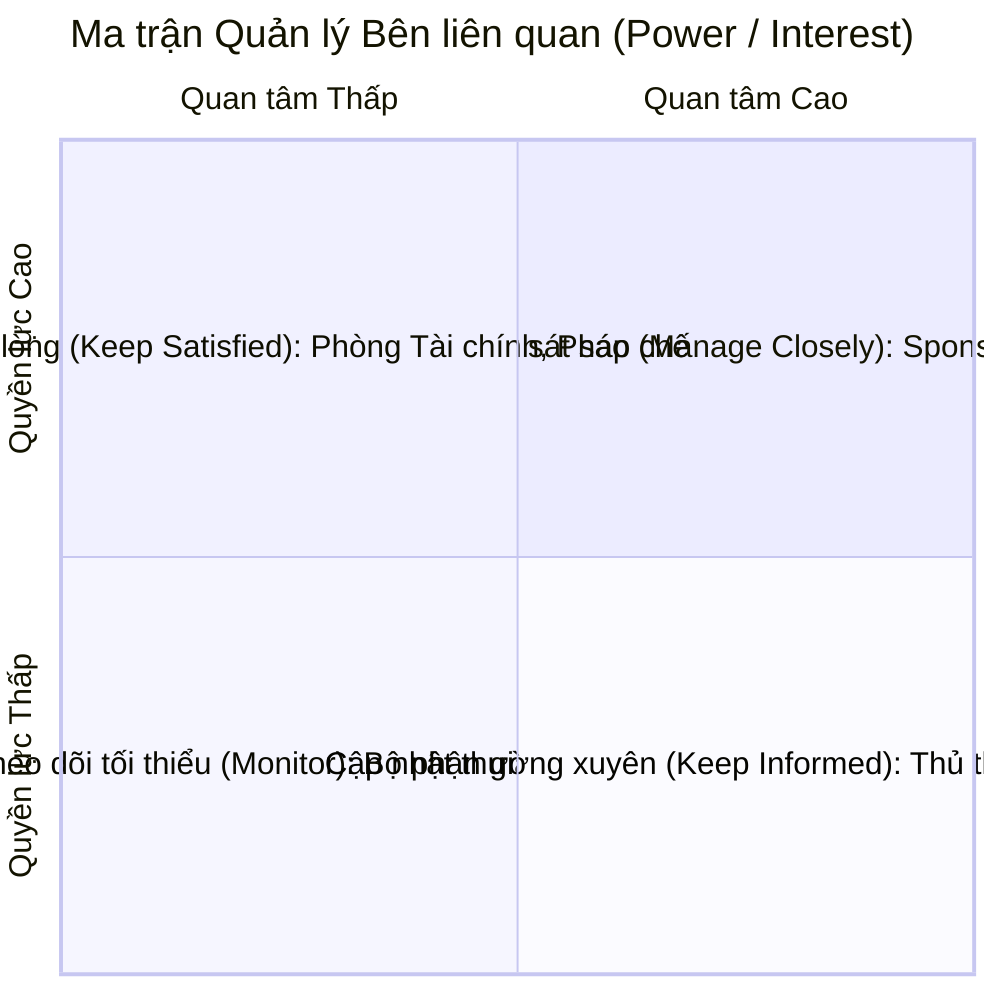

import QuickCheck from '../../../components/QuickCheck.astro';
import Quiz from '../../../components/Quiz.astro';
import ReflectBox from '../../../components/ReflectBox.astro';
import Term from '../../../components/Term.astro';

## Mục tiêu bài học (Thang Bloom)

Sau khi học xong bài này, bạn sẽ có khả năng:
- **Giải thích** vì sao một dự án phần mềm có thể bị dừng lại ngay từ giai đoạn Lập kế hoạch nhờ **Business Case** và **Phân tích khả thi (TELOS)**.
- **Xác định** rõ **In-Scope** và **Out-of-Scope** để ngăn chặn <Term id="scope-creep">Scope Creep</Term> từ ngày đầu.
- **Phân loại** các bên liên quan bằng **Ma trận Quyền lực / Mức quan tâm (Power–Interest Grid)**.
- **Áp dụng** công thức **ước lượng 3 điểm (PERT)** và lập bảng **Quản trị rủi ro (Risk Register)** ban đầu.

---

## 1. Bức tranh giai đoạn Lập kế hoạch

- **Đầu vào (Entry):** Nhu cầu / nỗi đau nghiệp vụ, chiến lược tổ chức, ngân sách dự kiến.
- **Hoạt động chính:** Lập Business Case → Phân tích khả thi (TELOS) → Khởi tạo Project Charter & Scope → Phân tích Stakeholder → Lập WBS, ước lượng sơ bộ & Risk Register.
- **Đầu ra (Exit):** **Business Case** & **Project Charter** được Sponsor ký phê duyệt (cổng Go / No-Go).

---

## 2. Phân tích Khả thi theo mô hình TELOS (5 khía cạnh)

Trước khi đổ tiền vào xây phần mềm, nhóm phải trả lời trung thực câu hỏi *"Dự án này có làm được và có đáng làm không?"* trên cả 5 mặt:

| Chữ | Khía cạnh khả thi | Câu hỏi kiểm chứng cốt lõi |
|---|---|---|
| **T** | **Technical** (Kỹ thuật) | Công nghệ, hạ tầng, năng lực đội ngũ và khả năng tích hợp hệ thống cũ (như SSO) có đáp ứng được không? |
| **E** | **Economic** (Kinh tế) | Tổng chi phí sở hữu (TCO: xây dựng + bản quyền + vận hành) so với lợi ích thu về (ROI, thời gian hoàn vốn) có xứng đáng không? |
| **L** | **Legal** (Pháp lý & Tuân thủ) | Có vướng quy định về bảo vệ dữ liệu cá nhân, bản quyền phần mềm, thuế hay tiêu chuẩn ngành không? |
| **O** | **Operational** (Vận hành) | Khi phần mềm làm xong, người dùng và phòng ban có sẵn sàng thay đổi thói quen để vận hành thật không? |
| **S** | **Schedule** (Tiến độ) | Mốc thời gian bắt buộc (ví dụ khai giảng sau 4 tháng) có khả thi thực tế với nguồn lực hiện có không? |

---

## 3. Phạm vi (Scope) & Phân tích Bên liên quan (Stakeholder Grid)

### a) Khóa chặt "Out-of-Scope" ngay từ đầu
Sai lầm kinh điển là chỉ liệt kê những gì **SẼ LÀM (In-Scope)** mà quên ghi rõ những gì **KHÔNG LÀM (Out-of-Scope)**.
- *Ví dụ LibCore:* Ghi rõ ngay ở Project Charter: *"Đợt 1 KHÔNG bao gồm phân hệ quản lý bán sách thương mại và KHÔNG bao gồm quản lý thư viện điện tử thu phí bản quyền"* → chặn đứng tranh cãi sau này.

### b) Ma trận Quyền lực – Mức quan tâm (Power / Interest Grid)

---

## 4. WBS, Ước lượng 3 điểm (PERT) & Quản trị Rủi ro ban đầu

### a) WBS (Work Breakdown Structure) & Ước lượng PERT
- **WBS** phân rã phạm vi sản phẩm thành các gói công việc nhỏ, không trùng lặp và cộng đủ 100% phạm vi (*Quy tắc 100%*).
- **Ước lượng 3 điểm (PERT):** Thay vì đoán 1 con số duy nhất dễ lạc quan quá mức, ta lấy 3 mốc: **O** (*Optimistic* – thuận lợi nhất), **M** (*Most Likely* – khả dĩ nhất), **P** (*Pessimistic* – xấu nhất):

> **Công thức PERT:** `E = (O + 4 × M + P) / 6`

*Ví dụ:* Tích hợp đăng nhập SSO có `O = 2` ngày, `M = 4` ngày, `P = 12` ngày → `E = (2 + 16 + 12) / 6 = 5` ngày (phản ánh thực tế hơn nhiều so với đoán lạc quan "khoảng 3 ngày").

### b) 4 Chiến lược ứng phó Rủi ro (Risk Response)
Mỗi rủi ro đánh giá theo **Xác suất (Probability) × Tác động (Impact)** và chọn 1 trong 4 chiến lược:
1. **Avoid (Tránh):** Đổi thiết kế/phạm vi để triệt tiêu hoàn toàn nguyên nhân rủi ro.
2. **Mitigate (Giảm thiểu):** Làm sớm hành động giảm xác suất hoặc tác động (ví dụ làm Spike thử kết nối SSO ở tuần 1).
3. **Transfer (Chuyển giao):** Chuyển rủi ro tài chính/kỹ thuật sang bên thứ ba (bảo hiểm, hợp đồng SLA nhà cung cấp).
4. **Accept (Chấp nhận):** Rủi ro nhỏ không đáng tốn chi phí phòng ngừa — chỉ lập dự phòng (contingency) nếu xảy ra.

<QuickCheck
  id="qc-m2-1"
  question="Một nhóm dự án phát hiện rủi ro cao là API đăng nhập SSO của nhà trường chưa từng có tài liệu chuẩn. Họ quyết định cử 1 kỹ sư làm thử nghiệm kết nối (Spike) ngay ở tuần đầu tiên để kiểm chứng. Đây là chiến lược ứng phó rủi ro nào?"
  options={[
    "Transfer (Chuyển giao)",
    "Mitigate (Giảm thiểu rủi ro sớm)",
    "Accept thụ động (Mặc kệ đến cuối dự án)",
    "Scope Creep"
  ]}
  correctIndex={1}
  explanation="Chủ động kiểm chứng kỹ thuật sớm giúp giảm mạnh xác suất bùng nổ sự cố tích hợp ở giai đoạn cuối → Mitigate (Giảm thiểu)."
/>

---

## 5. Tự giải thích & Kiểm tra thành thạo

<ReflectBox
  lessonId="m2"
  prompt="Hãy tóm tắt trong 3–4 câu: (1) 5 khía cạnh TELOS giúp kiểm chứng điều gì trước khi duyệt dự án, (2) Vì sao phải ghi rõ Out-of-Scope trong Project Charter, và (3) Công thức PERT (O + 4M + P)/6 giúp cải thiện ước lượng thế nào?"
  sampleKeyPoints={[
    "TELOS đánh giá toàn diện 5 mặt Kỹ thuật, Kinh tế, Pháp lý, Vận hành và Tiến độ để quyết định Go/No-Go có cơ sở.",
    "Ghi rõ Out-of-Scope giúp thống nhất kỳ vọng giữa các bên ngay từ đầu và tạo cơ sở chặn Scope Creep.",
    "PERT kết hợp kịch bản thuận lợi nhất, khả dĩ nhất và xấu nhất (nhấn trọng số 4 vào M) để hạn chế thiên lệch lạc quan quá mức."
  ]}
/>

<Quiz quizId="m2" />

---

## Nguồn tham khảo

- **PMI**, *PMBOK Guide – Eighth Edition* (Stakeholder, Planning & Uncertainty Performance Domains).
- **IIBA**, *BABOK Guide v3*, Chương 6 (Strategy Analysis – Business Case & Risk Analysis).
- **Ian Sommerville**, *Software Engineering* (10th ed.), Chương 22–23 (Project Management & Planning).
