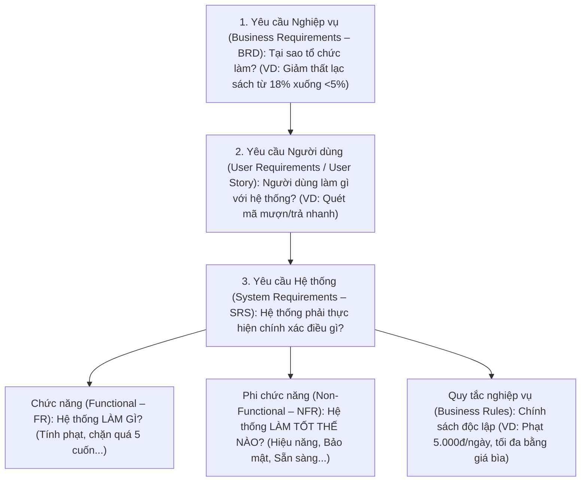

import QuickCheck from '../../../components/QuickCheck.astro';
import Quiz from '../../../components/Quiz.astro';
import ReflectBox from '../../../components/ReflectBox.astro';
import Term from '../../../components/Term.astro';

## Mục tiêu bài học (Thang Bloom)

Sau khi học xong bài này, bạn sẽ có khả năng:
- **Lựa chọn đúng** kỹ thuật khơi gợi yêu cầu (Phỏng vấn, Workshop, Quan sát, Khảo sát, Phân tích tài liệu, Prototype) theo từng bối cảnh.
- **Phân biệt** chính xác **3 cấp độ yêu cầu** (Business – User – System) và **Yêu cầu chức năng (FR)** vs **Yêu cầu phi chức năng (NFR)** theo **ISO/IEC 25010:2023**.
- **Nhận diện & Sửa lỗi** các câu yêu cầu mơ hồ, không đo kiểm được trong tài liệu **<Term id="srs">SRS</Term> (ISO/IEC/IEEE 29148:2018)**.
- **Áp dụng** phương pháp sắp xếp ưu tiên **MoSCoW** và quy trình thẩm định yêu cầu trước khi chốt Baseline.

---

## 1. 6 Kỹ thuật Khơi gợi Yêu cầu (Elicitation – BABOK v3)

Khơi gợi (Elicitation) KHÔNG phải là "đi thu thập yêu cầu có sẵn", vì người dùng thường không thể nói hết ngay những gì họ cần. Hãy phối hợp đúng kỹ thuật:

| Kỹ thuật | Mạnh nhất khi nào? | Điểm cần lưu ý |
|---|---|---|
| **Phỏng vấn (Interview)** | Cần khai thác sâu góc nhìn cá nhân của lãnh đạo hoặc chuyên gia nghiệp vụ | Chuẩn bị câu hỏi mở trước, gửi biên bản xác nhận lại sau buổi họp |
| **Workshop (Hội thảo)** | Nhiều phòng ban có lợi ích xung đột cần cùng thống nhất một quy trình chung | Cần người điều phối giữ đúng chủ đề & thời gian (Time-box) |
| **Quan sát thực tế (Observation / Job Shadowing)** | Người dùng làm theo thói quen khó diễn tả thành lời (ví dụ: quan sát thủ thư thao tác tại quầy giờ cao điểm) | Phát hiện các "bước ẩn" và ngoại lệ mà phỏng vấn không bao giờ nhắc tới |
| **Khảo sát (Survey / Questionnaire)** | Cần lấy ý kiến số đông nhanh (ví dụ: 18.000 sinh viên) | Câu hỏi phải ngắn, rõ, tránh câu hỏi dẫn dắt thiên vị |
| **Phân tích tài liệu (Document Analysis)** | Đã có quy chế, biểu mẫu giấy, hệ thống cũ hoặc quy định pháp luật | Luôn đối chiếu xem tài liệu cũ còn đúng với thực tế hiện tại không |
| **Prototype (Nguyên mẫu)** | Khách hàng chưa hình dung rõ màn hình/luồng thao tác | Nói rõ đây là bản mẫu kiểm chứng yêu cầu, không phải sản phẩm thật |

---

## 2. Phân loại Yêu cầu: 3 Cấp độ & Chức năng (FR) vs Phi chức năng (NFR)

### 9 đặc tính chất lượng cho Yêu cầu Phi chức năng (ISO/IEC 25010:2023)
Một bản SRS chuyên nghiệp KHÔNG BAO GIỜ chỉ ghi yêu cầu chức năng mà bỏ quên NFR (vì NFR quyết định kiến trúc!):
1. **Functional Suitability** (Độ phù hợp chức năng)
2. **Performance Efficiency** (Hiệu năng — thời gian phản hồi, thông lượng, tải đồng thời)
3. **Compatibility** (Tương thích & khả năng tích hợp hệ thống khác)
4. **Interaction Capability / Usability** (Khả năng sử dụng, hỗ trợ truy cập)
5. **Reliability** (Độ tin cậy — uptime 99,5%, khả năng phục hồi khi lỗi)
6. **Security** (Bảo mật — xác thực SSO, phân quyền RBAC, mã hóa, audit log)
7. **Maintainability** (Khả năng bảo trì & mở rộng)
8. **Flexibility / Portability** (Tính linh hoạt, chạy đa trình duyệt / thiết bị)
9. **Safety** (An toàn — bổ sung chính thức trong bản ISO/IEC 25010:2023)

---

## 3. Viết Yêu cầu chuẩn ISO/IEC/IEEE 29148 (Không mơ hồ, đo kiểm được)

Theo chuẩn **ISO/IEC/IEEE 29148:2018** và sách *Software Requirements* (Karl Wiegers), mỗi yêu cầu tốt phải đạt: **Rõ ràng (Unambiguous), Đầy đủ (Complete), Nhất quán (Consistent), Khả thi (Feasible), Có thể kiểm chứng (Verifiable) và Truy vết được (Traceable)**.

  

    
Yêu cầu VIẾT KÉM (Mơ hồ)

    <ul>
      <li>"Hệ thống tra cứu sách phải chạy <strong>nhanh</strong> và hỗ trợ <strong>nhiều</strong> sinh viên cùng lúc."</li>
      <li>"Hệ thống phải <strong>bảo mật cao</strong> và <strong>dễ dùng</strong>."</li>
      <li>"Quản trị viên có thể xuất báo cáo <strong>v.v.</strong>"</li>
    </ul>
  

  

    
Yêu cầu VIẾT CHUẨN (Đo kiểm được)

    <ul>
      <li>"Với <strong>500 người dùng đồng thời</strong>, 95% truy vấn tìm kiếm sách theo tên/ISBN phải trả kết quả trong <strong>≤ 1,5 giây</strong>."</li>
      <li>"Mọi phiên đăng nhập phải xác thực qua <strong>SSO OAuth2</strong>; phiên không hoạt động sau <strong>30 phút</strong> tự động đăng xuất."</li>
      <li>"Quản trị viên xuất được <strong>3 loại báo cáo cố định</strong> (Lượt mượn theo ngày, Sách quá hạn, Top 50 đầu sách) ra định dạng <strong>.xlsx và .pdf</strong>."</li>
    </ul>
  

---

## 4. Sắp xếp Ưu tiên bằng MoSCoW

Khi nguồn lực hữu hạn, ta dùng **MoSCoW** để tránh bẫy *"Cái gì khách hàng cũng bảo là Rất gấp"*:
- **M – Must have:** Bắt buộc phải có; thiếu 1 mục là bản phát hành vô nghĩa / không thể Go-Live (nên chiếm tối đa ~60% tổng nỗ lực để giữ vùng đệm an toàn).
- **S – Should have:** Quan trọng, nên có nếu kịp, nhưng có thể có cách làm tạm (workaround) ngắn hạn.
- **C – Could have:** Có thì tốt (nice-to-have), dễ dàng bỏ ra đầu tiên nếu tiến độ bị ép.
- **W – Won't have (this time):** Thống nhất rõ **chưa làm ở đợt này** (ghi nhận lại cho đợt sau để tránh Scope Creep).

<QuickCheck
  id="qc-m34-1"
  question="Câu yêu cầu nào dưới đây thuộc loại Yêu cầu Phi chức năng (Non-Functional Requirement) và ĐẠT chuẩn kiểm chứng được (Verifiable)?"
  options={[
    "Hệ thống cho phép thủ thư tạo phiếu mượn sách mới.",
    "Hệ thống phải hoạt động cực kỳ ổn định và ít lỗi.",
    "Hệ thống đạt độ sẵn sàng (uptime) tối thiểu 99,5% trong khung giờ hành chính 07:00–21:00 hằng ngày, và phục hồi sau sự cố (RTO) dưới 2 giờ.",
    "Mỗi sinh viên chỉ được mượn tối đa 5 cuốn sách cùng lúc."
  ]}
  correctIndex={2}
  explanation="Phương án A là yêu cầu chức năng; D là quy tắc nghiệp vụ; B là phi chức năng nhưng mơ hồ không đo được; C là yêu cầu phi chức năng (Reliability – ISO 25010) có ngưỡng định lượng rõ ràng."
/>

---

## 5. Tự giải thích & Kiểm tra thành thạo

<ReflectBox
  lessonId="m3-4"
  prompt="Hãy tóm tắt trong 3–4 câu: (1) Vì sao kỹ thuật Quan sát thực tế (Observation) lại bổ sung tốt cho Phỏng vấn, (2) Yêu cầu chức năng khác Phi chức năng ở đâu, và (3) Vì sao tuyệt đối tránh từ 'nhanh, đẹp, nhiều, v.v.' trong tài liệu SRS?"
  sampleKeyPoints={[
    "Quan sát thực tế giúp phát hiện các thao tác thói quen và ngoại lệ mà người dùng thường quên nhắc tới khi phỏng vấn.",
    "Yêu cầu chức năng mô tả hệ thống LÀM GÌ; yêu cầu phi chức năng (ISO 25010) mô tả chất lượng vận hành (hiệu năng, bảo mật, độ tin cậy...) và ảnh hưởng trực tiếp tới kiến trúc.",
    "Từ ngữ mơ hồ như 'nhanh, đẹp, v.v.' vi phạm chuẩn ISO 29148 (không kiểm chứng được – unverifiable), gây hiểu khác nhau giữa BA, Dev và QA."
  ]}
/>

<Quiz quizId="m3-4" />

---

## Nguồn tham khảo

- **ISO/IEC/IEEE 29148:2018**, *Requirements engineering* (Characteristics of well-formed requirements & SRS structure).
- **ISO/IEC 25010:2023**, *Systems and software Quality Requirements and Evaluation (SQuaRE) — Product quality model*.
- **Karl Wiegers & Joy Beatty**, *Software Requirements* (3rd ed.), Chương 7, 10, 14, 16.
- **IIBA**, *BABOK Guide v3*, Chương 4 (Elicitation and Collaboration) & Chương 7 (Requirements Analysis and Design Definition).
