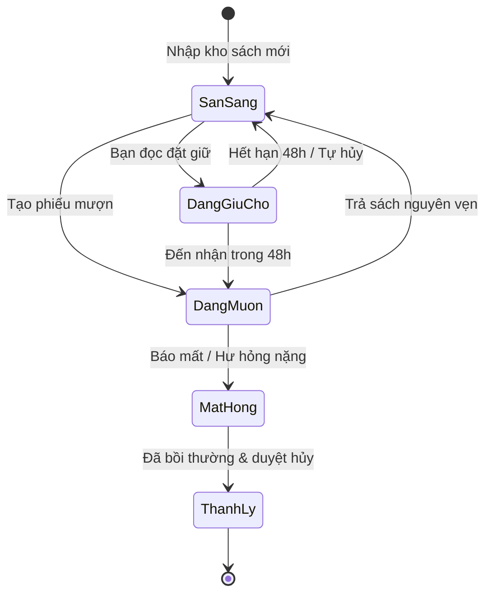
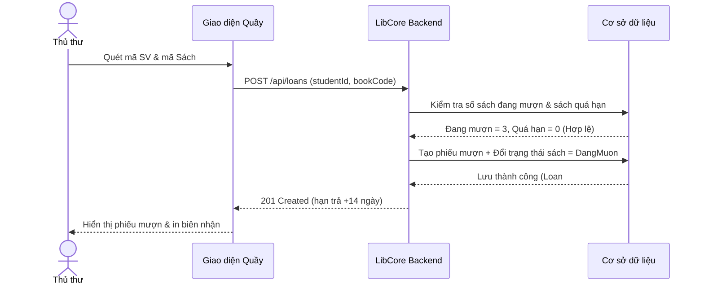

import QuickCheck from '../../../components/QuickCheck.astro';
import Quiz from '../../../components/Quiz.astro';
import ReflectBox from '../../../components/ReflectBox.astro';

## Mục tiêu bài học (Thang Bloom)

Sau khi học xong bài này, bạn sẽ có khả năng:
- **Chọn đúng** loại sơ đồ mô hình hóa (**BPMN, Use Case, Activity, Sequence, State, ERD, Wireframe**) cho đúng mục đích giao tiếp.
- **Đọc hiểu** một sơ đồ **Sequence Diagram** (tương tác giữa các hệ thống) và **State Diagram** (vòng đời trạng thái của đối tượng nghiệp vụ).
- **Phân biệt** **Thiết kế tổng thể (HLD)** và **Thiết kế chi tiết (LLD)**, cũng như đánh đổi giữa **Monolith** và **Microservices**.
- **Áp dụng** các nguyên tắc **Security by Design** cơ bản ngay từ bước thiết kế.

---

## 1. Bản đồ chọn đúng sơ đồ Mô hình hóa (Không vẽ thừa, không vẽ nhầm!)

Một sơ đồ tốt đáng giá hơn 10 trang văn bản — nhưng chỉ khi bạn chọn **đúng sơ đồ cho đúng câu hỏi**:

| Sơ đồ | Trả lời câu hỏi gì? | Khi nào dùng? |
|---|---|---|
| **BPMN 2.0** | Quy trình nghiệp vụ phối hợp qua **nhiều phòng ban/vai trò (Swimlanes)** diễn ra thế nào? | Mô tả quy trình nghiệp vụ đầu-cuối (mượn/trả, phê duyệt, xử lý ngoại lệ) cho cả nghiệp vụ lẫn kỹ thuật đọc |
| **UML Use Case** | Những tác nhân (Actor) nào tương tác với các chức năng lớn nào trong ranh giới hệ thống? | Chốt bức tranh tổng thể phạm vi chức năng với Stakeholders |
| **UML Activity** | Luồng các bước xử lý và nhánh rẽ điều kiện (If/Else, Song song) trong 1 chức năng ra sao? | Chi tiết hóa thuật toán nghiệp vụ của một Use Case |
| **UML Sequence** | Các thành phần (UI, Backend, Database, SSO...) **gọi nhau theo trình tự thời gian** thế nào? | Thiết kế tích hợp API, phân tích luồng đồng bộ/bất đồng bộ |
| **UML State Machine** | Một đối tượng (Phiếu mượn, Cuốn sách, Đơn hàng) chuyển qua **các trạng thái hợp lệ** nào? | Chặn lỗi chuyển trạng thái sai (ví dụ: không thể hủy phiếu đã hoàn tất!) |
| **ERD** | Dữ liệu gồm những thực thể nào và **quan hệ (1-1, 1-N, N-N)** ra sao? | Thống nhất mô hình dữ liệu giữa BA và đội phát triển DB |
| **Wireframe / Mockup** | Màn hình bố trí các trường nhập, nút bấm và luồng di chuyển thế nào? | Xác nhận trải nghiệm người dùng sớm trước khi code Frontend |

### Minh họa 1: Vòng đời trạng thái của một Cuốn sách (State Diagram — LibCore)

### Minh họa 2: Trình tự gọi hệ thống khi Mượn sách (Sequence Diagram — LibCore)

---

## 2. Thiết kế Tổng thể (HLD) vs Thiết kế Chi tiết (LLD)

| Khía cạnh | HLD (High-Level Design / Kiến trúc) | LLD (Low-Level Design / Thiết kế chi tiết) |
|---|---|---|
| **Trọng tâm** | Cấu trúc tổng thể các phân hệ, chọn công nghệ, luồng dữ liệu lớn, tích hợp ngoài, bảo mật tổng thể | Cấu trúc bảng DB chi tiết (kiểu dữ liệu, khóa, index), đặc tả chi tiết từng Endpoint API (JSON request/response, mã lỗi), thuật toán từng module |
| **Ánh xạ V-Model** | Đầu vào của **Integration Testing** | Đầu vào của **Unit / Component Testing** |
| **Người lập chính** | Solution Architect / Tech Lead | Tech Lead / Senior Developers |

### So sánh nhanh: Modular Monolith vs Microservices
- **Modular Monolith** *(khuyên dùng mặc định cho đa số dự án vừa và nhỏ như LibCore)*: Một khối mã nguồn triển khai thống nhất nhưng bên trong tách rõ các module độc lập. **Ưu:** Đơn giản, phát triển nhanh, dễ debug, dễ bảo đảm toàn vẹn giao dịch DB. **Nhược:** Khi quy mô lên hàng trăm kỹ sư sẽ khó mở rộng độc lập từng phần.
- **Microservices:** Tách thành nhiều dịch vụ độc lập có DB riêng, giao tiếp qua mạng (HTTP/Message Queue). **Ưu:** Mở rộng và triển khai độc lập từng dịch vụ. **Nhược:** Độ phức tạp vận hành, giám sát, lỗi mạng và nhất quán dữ liệu phân tán tăng vọt → **chỉ dùng khi tổ chức đủ lớn và có năng lực DevOps mạnh**.

---

## 3. Bảo mật ngay từ Thiết kế (Security by Design)

Không chờ viết xong phần mềm mới "đắp thêm bảo mật". Ngay ở giai đoạn Thiết kế cần chốt 4 lớp nền tảng:
1. **Nguyên tắc đặc quyền tối thiểu (Least Privilege) & RBAC:** Sinh viên chỉ xem được lịch sử của chính mình; chỉ Giám đốc Thư viện mới có quyền miễn/giảm tiền phạt.
2. **Xác thực & Phiên làm việc an toàn:** Mật khẩu băm bằng thuật toán an toàn (bcrypt/Argon2) hoặc dùng SSO chuẩn OAuth2/OIDC; mọi kết nối mã hóa HTTPS/TLS.
3. **Kiểm tra đầu vào ở phía Server (Server-side Validation):** Không bao giờ chỉ kiểm tra ở trình duyệt vì kẻ tấn công có thể gọi thẳng API.
4. **Nhật ký kiểm toán (Audit Log):** Ghi lại ai đã sửa/xóa dữ liệu nhạy cảm (như xóa tiền phạt, sửa điểm danh/phân quyền) vào thời điểm nào và không cho xóa log.

<QuickCheck
  id="qc-m56-1"
  question="BA cần kiểm tra kỹ xem một 'Phiếu đặt giữ sách' có bị lỗi cho phép chuyển thẳng từ trạng thái 'Đã hủy' sang 'Đã bàn giao sách' hay không. Loại sơ đồ nào giúp phát hiện lỗ hổng logic này rõ ràng nhất?"
  options={[
    "ERD (Entity-Relationship Diagram)",
    "UML State Machine Diagram (Sơ đồ chuyển trạng thái)",
    "Biểu đồ Gantt",
    "Sơ đồ tổ chức phòng ban"
  ]}
  correctIndex={1}
  explanation="State Machine Diagram liệt kê toàn bộ trạng thái hợp lệ và điều kiện chuyển đổi giữa chúng, giúp BA, Dev và QA dễ dàng phát hiện các bước chuyển trạng thái bất hợp lệ (cũng là đầu vào trực tiếp cho kỹ thuật State Transition Testing ở M8!)."
/>

---

## 4. Tự giải thích & Kiểm tra thành thạo

<ReflectBox
  lessonId="m5-6"
  prompt="Hãy tóm tắt trong 3–4 câu: (1) Sequence Diagram khác State Diagram ở câu hỏi nào nó trả lời, (2) Vì sao đa số dự án vừa và nhỏ nên bắt đầu bằng Modular Monolith thay vì Microservices ngay từ đầu, và (3) Vì sao không được chỉ kiểm tra dữ liệu hợp lệ ở phía trình duyệt (Frontend)?"
  sampleKeyPoints={[
    "Sequence Diagram mô tả trình tự gọi giữa các thành phần/hệ thống theo thời gian; State Diagram mô tả vòng đời và các bước chuyển trạng thái hợp lệ của một đối tượng nghiệp vụ.",
    "Microservices kéo theo độ phức tạp rất lớn về mạng, dữ liệu phân tán và vận hành DevOps; Modular Monolith giúp đi nhanh, đơn giản và vẫn giữ ranh giới module sạch để tách sau nếu cần.",
    "Người dùng hoặc kẻ tấn công có thể bỏ qua giao diện để gọi thẳng API nên Server luôn phải xác thực quyền và kiểm tra tính hợp lệ của dữ liệu."
  ]}
/>

<Quiz quizId="m5-6" />

---

## Nguồn tham khảo

- **Martin Fowler**, *UML Distilled* (3rd ed.) — Use Case, Activity, Sequence & State Machine Diagrams.
- **OMG**, *BPMN 2.0.2 Specification*.
- **Ian Sommerville**, *Software Engineering* (10th ed.), Chương 5 (System Modeling) & Chương 6 (Architectural Design).
- **IEEE Computer Society**, *SWEBOK Guide v4.0* (2024) — Software Architecture, Software Design & Software Security.
