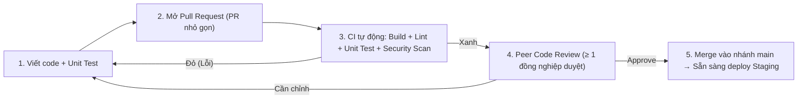

import QuickCheck from '../../../components/QuickCheck.astro';
import Quiz from '../../../components/Quiz.astro';
import ReflectBox from '../../../components/ReflectBox.astro';
import Term from '../../../components/Term.astro';

## Mục tiêu bài học (Thang Bloom)

Ngay cả khi bạn làm BA, PO hay QA, hiểu đúng giai đoạn Phát triển giúp bạn phối hợp cực mượt với đội kỹ thuật và đánh giá đúng rủi ro tiến độ:
- **Giải thích** vai trò của **Quản lý cấu hình & phân nhánh Git** (so sánh Trunk-Based Development và GitFlow).
- **Trình bày** quy trình **Pull Request & Code Review** và lý do không nên gộp một PR khổng lồ 2.000 dòng code.
- **Phân biệt** **Continuous Integration (CI)** với **Continuous Delivery / Deployment (CD)**.
- **Nhận diện** nguyên nhân và cách kiểm soát **<Term id="technical-debt">Nợ kỹ thuật (Technical Debt)</Term>** trước khi nó làm tê liệt tốc độ phát hành.

---

## 1. Chiến lược phân nhánh mã nguồn (Git Branching)

Mọi mã nguồn đều được lưu trên hệ thống quản lý phiên bản (Git) để truy vết ai sửa gì, khi nào và quay lại phiên bản cũ an toàn nếu lỗi:

| Chiến lược | Cơ chế | Khi nào phù hợp? |
|---|---|---|
| **Trunk-Based Development** *(hiện đại, khuyên dùng cho Agile/CI)* | Lập trình viên tách nhánh rất ngắn (1–2 ngày) từ nhánh chính `main`, test xanh qua CI rồi gộp về `main` liên tục | Đội Agile/DevOps phát hành thường xuyên; giảm tối đa "ác mộng xung đột mã nguồn" (merge conflict) |
| **GitFlow** | Duy trì nhiều nhánh dài ngày (`main`, `develop`, `feature/*`, `release/*`, `hotfix/*`) | Phần mềm đóng gói phát hành theo từng phiên bản lớn cố định (v1.0, v2.0) cần hỗ trợ song song nhiều phiên bản cũ |

---

## 2. Pull Request, Code Review & Pipeline CI

### Quy tắc vàng để Code Review thực sự có ích
- **PR nhỏ (< 300–400 dòng):** Một PR 2.000 dòng sẽ chỉ nhận lại chữ "LGTM" (duyệt qua loa) vì người duyệt không đủ sức đọc kỹ.
- **Tự động hóa những thứ máy làm tốt:** Format code, quy tắc đặt tên, lỗi cú pháp hãy để Linter & CI lo — con người tập trung kiểm tra **đúng logic nghiệp vụ, bảo mật, ngoại lệ và dễ đọc**.
- **Góp ý về code, không công kích người viết** (giữ giá trị Tôn trọng).

### Phân biệt CI vs Continuous Delivery vs Continuous Deployment
- **Continuous Integration (CI):** Tự động build và chạy kiểm thử tự động mỗi khi có commit/PR gộp vào nhánh chung để phát hiện xung đột sớm.
- **Continuous Delivery (CD):** Mở rộng CI — mọi bản build xanh luôn sẵn sàng triển khai lên Production chỉ bằng **1 nút bấm phê duyệt thủ công**.
- **Continuous Deployment (CD):** Mọi thay đổi vượt qua toàn bộ kiểm thử tự động sẽ **tự động triển khai thẳng lên Production** không cần bấm nút tay.

---

## 3. Nợ kỹ thuật (Technical Debt) — Khi "làm nhanh" trở thành "làm chậm"

Giống như vay tiền trả góp: đôi khi đội cố ý chọn giải pháp đơn giản để kịp mốc khai giảng (**nợ có chủ đích**), nhưng nếu không trả nợ gốc bằng **Refactoring** định kỳ, "tiền lãi" (thời gian hiểu code, sửa 1 chỗ hỏng 3 chỗ khác) sẽ phình to tới mức mỗi Sprint chỉ đủ sức chữa cháy.

<QuickCheck
  id="qc-m7-1"
  question="Nhóm phát triển để 4 lập trình viên làm trên 4 nhánh feature riêng suốt 5 tuần mới gộp lại vào nhánh chính một lần trước ngày kiểm thử. Rủi ro lớn nhất là gì?"
  options={[
    "Máy chủ Git bị hết dung lượng ổ cứng.",
    "Xung đột mã nguồn (merge conflict) nặng nề và lỗi tích hợp bị giấu suốt 5 tuần mới bùng phát cùng lúc ('Integration Hell').",
    "Không thể viết tài liệu HDSD.",
    "Không có rủi ro gì nếu mỗi người tự test nhánh của mình."
  ]}
  correctIndex={1}
  explanation="Gộp nhánh quá thưa tạo ra 'Integration Hell'. Thực hành Continuous Integration (CI) yêu cầu gộp nhỏ và thường xuyên (hằng ngày hoặc mỗi 1–2 ngày) để phát hiện xung đột ngay khi còn rất nhỏ."
/>

---

## 4. Tự giải thích & Kiểm tra thành thạo

<ReflectBox
  lessonId="m7"
  prompt="Hãy tóm tắt trong 3–4 câu: (1) Continuous Integration (CI) giải quyết vấn đề gì, (2) Continuous Delivery khác Continuous Deployment ở điểm nào, và (3) Vì sao Nợ kỹ thuật không được bỏ mặc mãi?"
  sampleKeyPoints={[
    "CI tự động build và kiểm thử mỗi khi gộp code thường xuyên để tránh Integration Hell và phát hiện lỗi vỡ chức năng ngay trong ngày.",
    "Continuous Delivery đảm bảo bản build luôn sẵn sàng phát hành nhưng bước đẩy lên Production vẫn có nút duyệt thủ công; Continuous Deployment đẩy thẳng lên Production hoàn toàn tự động.",
    "Nếu không trả nợ kỹ thuật qua Refactoring định kỳ, mã nguồn ngày càng rối và dễ vỡ, làm tốc độ phát triển các tính năng mới chậm dần về gần bằng 0."
  ]}
/>

<Quiz quizId="m7" />

---

## Nguồn tham khảo

- **IEEE Computer Society**, *SWEBOK Guide v4.0* (2024) — Software Construction & Software Configuration Management.
- **Gene Kim et al.**, *The DevOps Handbook* (2nd ed.) — Continuous Integration & Technical Debt.
- **Ian Sommerville**, *Software Engineering* (10th ed.), Chương 7 (Design and Implementation) & Chương 25 (Configuration Management).
