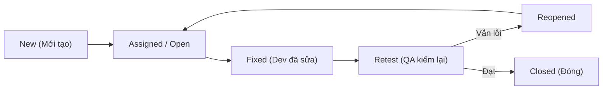

import QuickCheck from '../../../components/QuickCheck.astro';
import Quiz from '../../../components/Quiz.astro';
import ReflectBox from '../../../components/ReflectBox.astro';
import Term from '../../../components/Term.astro';

## Mục tiêu bài học (Thang Bloom)

Sau khi học xong bài này, bạn sẽ nắm vững toàn bộ khung kiểm thử cốt lõi tương đương **ISTQB CTFL v4.0 (Chương 1, 2, 4, 5)**:
- **Giải thích** được **7 nguyên tắc kiểm thử phần mềm** và lý do không thể "test 100% không còn lỗi nào".
- **Phân biệt** rõ **4 cấp độ kiểm thử** (Unit → Integration → System → Acceptance/UAT) và **Kiểm thử tĩnh vs động**.
- **Áp dụng thành thạo 4 kỹ thuật thiết kế test hộp đen** (*Phân vùng tương đương, Giá trị biên, Bảng quyết định, Chuyển trạng thái*) vào bài toán thật.
- **Phân biệt** **Severity** vs **Priority** trong quản lý lỗi và sử dụng **<Term id="rtm">Ma trận truy vết yêu cầu (RTM)</Term>**.

---

## 1. 7 Nguyên tắc Kiểm thử kinh điển (ISTQB CTFL v4.0)

1. **Kiểm thử chỉ ra sự hiện diện của lỗi, KHÔNG thể chứng minh phần mềm không còn lỗi.**
2. **Kiểm thử vét cạn (Exhaustive testing) là bất khả thi** (trừ trường hợp cực tầm thường) → phải dùng kỹ thuật thiết kế test và quản trị rủi ro.
3. **Kiểm thử sớm tiết kiệm thời gian và tiền bạc (Shift-Left):** Bắt đầu ngay từ rà soát SRS/User Story.
4. **Lỗi có xu hướng tập trung thành cụm (Defects cluster together — nguyên lý Pareto 80/20):** Phần lớn lỗi tập trung ở một số ít module phức tạp.
5. **Nghịch lý thuốc trừ sâu (Tests wear out / Pesticide paradox):** Chạy đi chạy lại mãi một bộ test cũ sẽ không tìm ra lỗi mới → cần thường xuyên rà soát và bổ sung test case mới.
6. **Kiểm thử phụ thuộc vào ngữ cảnh (Context-dependent):** Cách test phần mềm máy bay khác hoàn toàn cách test website bán hàng.
7. **Ngộ nhận "hết lỗi là sản phẩm thành công" (Absence-of-defects fallacy):** Phần mềm chạy 0 lỗi nhưng không đáp ứng nhu cầu người dùng (trượt Validation) vẫn là sản phẩm thất bại!

---

## 2. 4 Cấp độ Kiểm thử & Kiểm thử Tĩnh vs Động

| Cấp độ kiểm thử | Đối tượng kiểm tra | Ai thực hiện chính? | Mục tiêu |
|---|---|---|---|
| **1. Component / Unit Test** | Từng hàm, lớp, thành phần độc lập | Developers | Kiểm tra logic nội bộ đúng thiết kế chi tiết |
| **2. Integration Test** | Sự tương tác giữa các module, API, DB, SSO | Developers / QA | Bắt lỗi giao diện kết nối, định dạng JSON, phân quyền liên tầng |
| **3. System Test** | Toàn bộ hệ thống tích hợp hoàn chỉnh (chức năng + phi chức năng) | QA / QC độc lập | Đối chiếu hệ thống với toàn bộ SRS & yêu cầu hiệu năng/bảo mật |
| **4. Acceptance Test (<Term id="uat">UAT</Term>)** | Nghiệp vụ đầu-cuối trên môi trường giống thực tế | Đại diện người dùng cuối / PO (BA hỗ trợ) | Xây dựng niềm tin để ký xác nhận sẵn sàng Go-Live |

- **Kiểm thử tĩnh (Static Testing):** KHÔNG chạy mã nguồn — gồm rà soát SRS, rà soát thiết kế, Walkthrough, Inspection, phân tích code tĩnh (Static Analysis). Rất rẻ và bắt lỗi cực sớm!
- **Kiểm thử động (Dynamic Testing):** Chạy phần mềm với dữ liệu đầu vào thực tế để quan sát kết quả.
- **Confirmation Testing (Re-testing) vs Regression Testing:** *Re-testing* kiểm tra lại đúng lỗi vừa sửa xem đã hết chưa; *Regression Testing* kiểm tra các chức năng xung quanh đảm bảo việc sửa lỗi/thêm tính năng không làm hỏng phần vốn đang chạy tốt.

---

## 3. 4 Kỹ thuật thiết kế Test Hộp đen (Black-box — Bắt buộc phải làm được!)

### a) Phân vùng tương đương (Equivalence Partitioning – EP) & Phân tích Giá trị biên (Boundary Value Analysis – BVA)
*Bài toán trên LibCore:* Quy chế cho phép sinh viên mượn số lượng sách hợp lệ từ **1 đến 5 cuốn** (số nguyên).
- **3 phân vùng tương đương (EP):**
  - Vùng không hợp lệ thấp: `≤ 0` (ví dụ `0`, `-2`) → Hệ thống từ chối.
  - Vùng hợp lệ: `1..5` (ví dụ `3`) → Hệ thống chấp nhận.
  - Vùng không hợp lệ cao: `≥ 6` (ví dụ `8`) → Hệ thống từ chối.
- **Giá trị biên 2 điểm (2-value BVA — nơi lập trình viên dễ sai dấu `<` với `<=` nhất!):**
  - Biên dưới: **`0`** (không hợp lệ) và **`1`** (hợp lệ).
  - Biên trên: **`5`** (hợp lệ) và **`6`** (không hợp lệ).

### b) Bảng quyết định (Decision Table Testing) — Cho nhiều điều kiện kết hợp
*Bài toán LibCore:* Sinh viên chỉ được mượn sách mới khi **đồng thời** thỏa 3 điều kiện: (1) Thẻ còn hạn, (2) Đang mượn `< 5` cuốn, (3) Không có sách quá hạn.

| Điều kiện / Kết quả | Luật 1 | Luật 2 | Luật 3 | Luật 4 |
|---|:---:|:---:|:---:|:---:|
| Thẻ thư viện còn hạn? | Đúng | Đúng | Đúng | Sai |
| Đang mượn < 5 cuốn? | Đúng | Đúng | Sai | *(Không xét)* |
| Không có sách quá hạn? | Đúng | Sai | *(Không xét)* | *(Không xét)* |
| **Kết quả hệ thống** | **Cho mượn** | **Chặn (Quá hạn)** | **Chặn (Đạt trần 5 cuốn)** | **Chặn (Thẻ hết hạn)** |

### c) Kiểm thử Chuyển trạng thái (State Transition Testing)
Dùng trực tiếp sơ đồ trạng thái (đã vẽ ở M5–M6) để sinh cả 2 nhóm test:
- **Chuyển hợp lệ:** `Sẵn sàng` → `Đang giữ chỗ` → `Đang mượn` → `Sẵn sàng`.
- **Chuyển BẤT hợp lệ (rất hay có bug!):** Thử gọi API chuyển thẳng từ `Đã thanh lý` về `Đang mượn` → Hệ thống bắt buộc phải chặn (HTTP 400/409).

---

## 4. Vòng đời Lỗi, Severity vs Priority & RTM

### Phân biệt Severity (Mức nghiêm trọng) và Priority (Mức ưu tiên sửa)
- **Severity:** Mức độ tàn phá về mặt **kỹ thuật/chức năng** của lỗi (do QA đánh giá).
- **Priority:** Mức độ **khẩn cấp về mặt kinh doanh** cần sửa sớm hay muộn (do PO/PM quyết định).
- *Ví dụ High Priority nhưng Low Severity:* Logo tên trường trên trang chủ bị viết sai chính tả ngay trước lễ khai giảng (không làm sập hệ thống → Low Severity, nhưng cực mất mặt → High Priority!).
- *Ví dụ High Severity nhưng Low Priority:* Tính năng xuất báo cáo quyết toán cuối năm bị sập (High Severity), nhưng còn 8 tháng nữa mới tới kỳ quyết toán nên xếp ưu tiên sửa sau các tính năng khai giảng (Low Priority).

### Ma trận Truy vết Yêu cầu (RTM)
RTM nối hai chiều: `Yêu cầu (REQ-01)` ↔ `User Story` ↔ `Thiết kế` ↔ `Test Case (TC-01..TC-04)` ↔ `Bug`. Nhờ RTM, trước khi Go-Live bạn biết ngay **100% yêu cầu Must-have đã có test case phủ kín chưa**, và khi 1 yêu cầu thay đổi bạn biết chính xác những test case nào cần chạy lại.

<QuickCheck
  id="qc-m8-1"
  question="Hệ thống quy định nhập số ngày gia hạn sách hợp lệ từ 1 đến 7 ngày (số nguyên). Theo kỹ thuật Phân tích Giá trị biên 2 điểm (2-value BVA – ISTQB), bộ 4 giá trị đầu vào nào kiểm tra đủ hai biên hợp lệ và sát biên không hợp lệ?"
  options={[
    "1, 3, 5, 7",
    "0, 1, 7, 8",
    "-5, 2, 6, 20",
    "1, 2, 6, 7"
  ]}
  correctIndex={1}
  explanation="Với miền [1..7], giá trị biên dưới là 1 (sát ngoài là 0) và biên trên là 7 (sát ngoài là 8) → bộ 2-value BVA chuẩn là {0, 1, 7, 8}."
/>

---

## 5. Tự giải thích & Kiểm tra thành thạo

<ReflectBox
  lessonId="m8"
  prompt="Hãy tóm tắt trong 3–4 câu: (1) Confirmation Testing khác Regression Testing thế nào, (2) Vì sao cần phân biệt Severity và Priority kèm 1 ví dụ, và (3) Ma trận RTM mang lại 2 lợi ích lớn nhất nào?"
  sampleKeyPoints={[
    "Confirmation Testing (Re-testing) kiểm tra lại đúng lỗi vừa sửa xem đã hết chưa; Regression Testing kiểm tra các phần xung quanh đảm bảo việc sửa code không làm hỏng chức năng cũ.",
    "Severity đo mức tàn phá kỹ thuật còn Priority đo độ gấp về kinh doanh (ví dụ: sai chính tả tên thương hiệu trang chủ trước ngày ra mắt là Low Severity nhưng High Priority).",
    "RTM giúp đảm bảo 100% yêu cầu đều có test case kiểm chứng (không sót) và hỗ trợ phân tích tác động nhanh khi có yêu cầu thay đổi."
  ]}
/>

<Quiz quizId="m8" />

---

## Nguồn tham khảo

- **ISTQB**, *Certified Tester Foundation Level (CTFL) Syllabus v4.0*, Chương 1, 2, 3, 4 (EP, BVA, Decision Table, State Transition) & Chương 5 (Defect Management).
- **Lee Copeland**, *A Practitioner's Guide to Software Test Design*.
