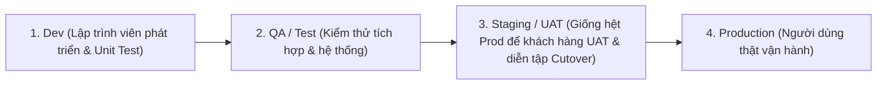

import QuickCheck from '../../../components/QuickCheck.astro';
import Quiz from '../../../components/Quiz.astro';
import ReflectBox from '../../../components/ReflectBox.astro';

## Mục tiêu bài học (Thang Bloom)

Sau khi học xong bài này, bạn sẽ có khả năng:
- **Phân biệt** vai trò của 4 môi trường chuẩn (**Dev – Test/QA – UAT/Staging – Production**).
- **Chọn đúng** chiến lược triển khai (**Big Bang, Phased, Parallel, Pilot, Blue-Green, Canary**) và thiết lập kế hoạch **Rollback**.
- **Phân biệt** chính xác **4 loại bảo trì phần mềm** (*Corrective, Adaptive, Perfective, Preventive*).
- **Trình bày** quy trình quản lý **Change Request**, khái niệm **Incident vs Problem (ITIL)** và giai đoạn cuối hay bị bỏ quên: **Ngừng hệ thống (Decommissioning)**.

---

## 1. Hệ thống Môi trường chuẩn trước khi lên Production

Không bao giờ phát triển hay thử nghiệm trực tiếp trên môi trường người dùng thật! Một hệ thống chuyên nghiệp tách bạch ít nhất 4 môi trường:

---

## 2. 6 Chiến lược Triển khai (Go-Live / Deployment Strategies)

| Chiến lược | Cách vận hành | Ưu điểm | Nhược điểm / Khi nào dùng? |
|---|---|---|---|
| **Big Bang** | Tắt toàn bộ hệ thống cũ và bật hệ thống mới cho 100% người dùng cùng một lúc | Nhanh, không phải đồng bộ dữ liệu song song | Rủi ro cực cao nếu lỗi lớn → chỉ dùng cho hệ thống nhỏ hoặc khi không thể chạy song song |
| **Phased (Theo giai đoạn)** | Triển khai từng phân hệ hoặc từng cơ sở/chi nhánh theo lộ trình | Cô lập rủi ro, đội hỗ trợ dễ xử lý | Cần cầu nối dữ liệu tạm giữa phần mới và phần cũ |
| **Parallel (Chạy song song)** | Vận hành cả hệ thống cũ lẫn mới cùng lúc một thời gian để đối chiếu kết quả | An toàn rất cao (thường dùng cho tài chính/lương) | Tốn gấp đôi công nhập liệu và hạ tầng |
| **Pilot (Thí điểm)** | Chọn một nhóm nhỏ người dùng (ví dụ 1 cơ sở thư viện nhỏ) dùng thật trước khi nhân rộng | Phản hồi thực tế an toàn, chi phí thấp | Thời gian phủ toàn tổ chức chậm hơn |
| **Blue–Green** *(DevOps)* | Hai môi trường giống hệt nhau: **Blue** đang chạy thật, triển khai bản mới lên **Green** → test ổn → chuyển lưu lượng sang Green tức thì | **Downtime ≈ 0**, Rollback chỉ mất vài giây (đảo ngược lại Blue) | Tốn chi phí nhân đôi hạ tầng lúc triển khai |
| **Canary Release** *(DevOps)* | Chuyển dần 5% → 20% → 50% → 100% lưu lượng người dùng sang bản mới kết hợp giám sát lỗi thời gian thực | Giảm thiểu bán kính ảnh hưởng nếu bản mới có lỗi ẩn | Đòi hỏi hệ thống giám sát (monitoring) & routing tự động tốt |

:::caution[Kế hoạch Rollback & Diễn tập chuyển đổi dữ liệu (Data Migration)]
Trước ngày Go-Live phải luôn có **Kế hoạch quay lui (Rollback Plan)** và mốc quyết định **Go / No-Go**. Với dự án thay hệ thống cũ (như LibCore nhập 120.000 đầu sách từ phần mềm 2012), bắt buộc chạy thử **Data Migration Dry-run** trên Staging để đối soát 100% dữ liệu trước khi cắt chuyển thật (Cutover).
:::

---

## 3. Vận hành, Bảo trì & Quản lý Thay đổi (Giai đoạn 7)

Phần lớn tổng chi phí vòng đời phần mềm (thường **60–80%**) nằm ở giai đoạn **Vận hành & Bảo trì** chứ không phải giai đoạn xây mới ban đầu!

### 4 loại Bảo trì phần mềm chuẩn (ISO/IEC 14764 & SWEBOK v4)

| Loại bảo trì | Mục đích | Ví dụ thực tế trên LibCore |
|---|---|---|
| **1. Corrective** (Sửa lỗi) | Khắc phục sự cố/bug phát sinh sau khi vận hành | Sửa lỗi tính sai tiền phạt khi sách trả đúng ngày Chủ nhật |
| **2. Adaptive** (Thích ứng) | Điều chỉnh phần mềm để tương thích với **môi trường/quy định bên ngoài thay đổi** | Cập nhật hệ thống khi nhà trường nâng cấp máy chủ SSO lên giao thức mới hoặc đổi quy định pháp lý |
| **3. Perfective** (Hoàn thiện) | Bổ sung tính năng mới hoặc cải thiện hiệu năng/trải nghiệm theo yêu cầu người dùng | Thêm chế độ gợi ý sách liên quan và tối ưu tốc độ tìm kiếm nhanh hơn 2 lần |
| **4. Preventive** (Phòng ngừa) | Cải tiến cấu trúc nội bộ (Refactoring, nâng cấp thư viện bảo mật) để **ngăn lỗi tương lai** | Nâng cấp phiên bản framework sắp hết hỗ trợ bảo mật (EOL) và dọn nợ kỹ thuật |

### ITIL cơ bản: Phân biệt Incident, Problem và Change Request
- **Incident (Sự cố):** Gián đoạn dịch vụ cần **khôi phục hoạt động nhanh nhất có thể** theo cam kết **SLA** (ví dụ: khởi động lại dịch vụ quét mã bị treo để thủ thư làm việc tiếp).
- **Problem (Vấn đề gốc rễ):** Điều tra tìm **nguyên nhân sâu xa (Root Cause)** khiến sự cố lặp đi lặp lại để xử lý dứt điểm vĩnh viễn.
- **Change Request (CR):** Mọi thay đổi lên hệ thống đã vận hành phải qua **Đánh giá tác động (Impact Analysis)** → **Phê duyệt (CCB / PO)** → **Triển khai & cập nhật Baseline**.

### Giai đoạn cuối hay bị quên: Ngừng hệ thống (Decommissioning / Retirement)
Theo **ISO/IEC/IEEE 12207:2017**, một vòng đời chỉ khép lại trọn vẹn khi hệ thống cũ được ngừng đúng chuẩn:
1. Thông báo trước cho người dùng và hoàn tất di chuyển dữ liệu sang hệ thống mới.
2. Lưu trữ dữ liệu lịch sử (Archive) theo thời hạn lưu trữ bắt buộc của pháp luật/tổ chức.
3. Thu hồi tài khoản, hủy khóa bảo mật/chứng chỉ và tắt hạ tầng để cắt chi phí + tránh lỗ hổng bảo mật bị bỏ quên.

<QuickCheck
  id="qc-m910-1"
  question="Trình duyệt Chrome ra bản cập nhật mới làm tính năng in biên lai của phần mềm thư viện bị lệch khổ giấy, đội kỹ thuật phải cập nhật mã nguồn để phần mềm chạy khớp lại với trình duyệt mới. Đây là loại bảo trì nào?"
  options={[
    "Preventive Maintenance (Phòng ngừa)",
    "Adaptive Maintenance (Thích ứng với thay đổi môi trường bên ngoài)",
    "Perfective Maintenance (Hoàn thiện thêm tính năng mới)",
    "Ngừng hệ thống (Decommissioning)"
  ]}
  correctIndex={1}
  explanation="Điều chỉnh phần mềm để tương thích khi hệ điều hành, trình duyệt, phần cứng, API bên ngoài hoặc luật pháp thay đổi chính là Adaptive Maintenance."
/>

---

## 4. Tự giải thích & Kiểm tra thành thạo

<ReflectBox
  lessonId="m9-10"
  prompt="Hãy tóm tắt trong 3–4 câu: (1) Blue-Green Deployment khác Canary Release ở điểm nào, (2) Phân biệt ngắn gọn 4 loại bảo trì phần mềm, và (3) Incident khác Problem trong vận hành ITIL thế nào?"
  sampleKeyPoints={[
    "Blue-Green chuyển 100% lưu lượng tức thì sang môi trường mới (rollback cực nhanh); Canary chuyển dần từng tỷ lệ nhỏ (5% → 20% → 100%) kết hợp giám sát để giảm bán kính rủi ro.",
    "Corrective sửa lỗi đang có; Adaptive thích ứng với thay đổi môi trường/pháp lý; Perfective thêm tính năng/tối ưu trải nghiệm; Preventive phòng ngừa lỗi tương lai (refactoring, vá bảo mật).",
    "Incident tập trung khôi phục dịch vụ nhanh nhất theo SLA; Problem tập trung tìm và triệt tiêu tận gốc nguyên nhân (Root Cause) gây lặp sự cố."
  ]}
/>

<Quiz quizId="m9-10" />

---

## Nguồn tham khảo

- **ISO/IEC/IEEE 12207:2017** (Transition, Operation, Maintenance & Disposal processes) & **ISO/IEC 14764** (Software Maintenance).
- **IEEE Computer Society**, *SWEBOK Guide v4.0* (2024) — Software Maintenance & Software Engineering Operations.
- **Ian Sommerville**, *Software Engineering* (10th ed.), Chương 9 (Software Evolution).
