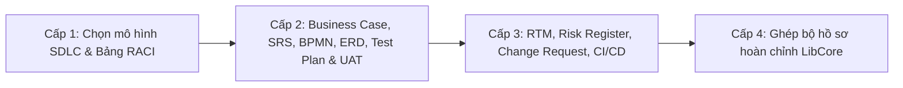

Để kiến thức SDLC không nằm trên giấy, toàn bộ các bài tập thực hành từ Cấp 1 đến Cấp 4 đều xoay quanh một dự án hư cấu duy nhất: **Hệ thống Quản lý Thư viện Đại học — LibCore**.

## 1. Bối cảnh & Vấn đề hiện tại

Thư viện Trường Đại học Bình Minh có **120.000 đầu sách**, phục vụ **18.000 sinh viên và giảng viên** tại 2 cơ sở. Hiện tại thư viện dùng phần mềm cũ từ năm 2012 kết hợp sổ Excel, gây ra 4 vấn đề lớn:
- Sinh viên không tra cứu được sách còn hay hết trên điện thoại, phải đến tận quầy mới biết.
- Quy trình mượn/trả mất trung bình 4–5 phút/lượt vì thủ thư phải nhập mã thủ công.
- Tính tiền phạt trễ hạn và nhắc lịch trả sách làm thủ công nên tỷ lệ thất lạc và trễ hạn lên tới 18%.
- Ban Giám hiệu không có báo cáo thời gian thực về đầu sách được mượn nhiều nhất để lập ngân sách mua sách năm sau.

## 2. Các nhóm người dùng & bên liên quan

| Nhóm | Vai trò trong hệ thống | Mục tiêu chính |
|---|---|---|
| **Ban Giám hiệu (Sponsor)** | Cấp ngân sách & duyệt mốc lớn | Đưa hệ thống vào vận hành đúng khai giảng học kỳ mới (sau 6 tháng), không vượt ngân sách trần |
| **Giám đốc Thư viện (PO / Đại diện nghiệp vụ)** | Chốt quy chế mượn/trả, mức phạt, ưu tiên tính năng | Giảm thời gian phục vụ tại quầy, kiểm soát thất lạc sách |
| **Thủ thư (12 người)** | Người dùng thao tác hằng ngày | Quét mã vạch mượn/trả nhanh, quản lý kho sách, xử lý đặt trước và thu phạt chính xác |
| **Bạn đọc (Sinh viên, Giảng viên)** | Người dùng cổng tra cứu & đặt sách | Tra cứu sách, đặt giữ sách online, xem hạn trả và gia hạn từ xa |
| **Phòng CNTT nhà trường** | Vận hành hạ tầng & tích hợp đăng nhập sinh viên (SSO) | Hệ thống ổn định, bảo mật, dễ sao lưu và bảo trì |

## 3. Các ràng buộc dự án

1. **Ngân sách cố định ở mức trần** đã được Hội đồng trường duyệt cho năm tài chính.
2. **Mốc thời gian bắt buộc:** Phải vận hành được **gói tính năng lõi** (Tra cứu, Mượn/Trả, Quản lý bạn đọc, Nhập kho sách) đúng dịp khai giảng sau **4 tháng**; các tính năng nâng cao (Đặt trước online, Tự động nhắc hạn, Báo cáo phân tích) có thể ra mắt ở đợt tiếp theo (tháng thứ 6).
3. **Độ rõ yêu cầu:** Quy chế mượn/trả và công thức phạt đã khá rõ, nhưng **giao diện cổng tra cứu cho sinh viên** và **luồng đặt giữ sách** cần thủ thư & sinh viên dùng thử rồi tinh chỉnh dần.
4. **Sự tham gia của nghiệp vụ:** Giám đốc Thư viện và 2 thủ thư trưởng cam kết dành **3 giờ mỗi tuần** để họp rà soát và góp ý bản demo.

## 4. Lộ trình sản phẩm bạn sẽ tự tạo xuyên suốt khóa học

Hãy chuyển sang [Bài tập Cấp 1](/du-an-mo-phong/bai-tap-cap-1/) để bắt đầu sản phẩm đầu tiên của bạn!
