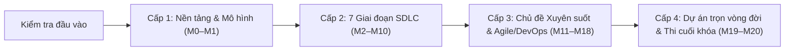

import { Card, CardGrid } from '@astrojs/starlight/components';

## Học để nắm thật chắc, không học lướt

<CardGrid>
  <Card title="Học tới thành thạo (Ngưỡng 80%)" icon="approve-check">
    Mỗi bài học đều có câu hỏi kiểm tra nhanh xen giữa bài, quiz cuối bài kèm giải thích chi tiết và nguồn trích dẫn. Chỉ khi đạt ≥ 80% mới tính là hoàn thành.
  </Card>
  <Card title="Nhớ lâu bằng Flashcard SRS" icon="rocket">
    Hệ thống thẻ ghi nhớ tự lên lịch ôn theo hộp Leitner (1 → 3 → 7 → 14 → 30 ngày) giúp kiến thức chuyển sang trí nhớ dài hạn thay vì học xong rồi quên.
  </Card>
  <Card title="Thực hành trên Dự án mô phỏng" icon="pencil">
    Xuyên suốt khóa học, bạn sẽ tự lập đầy đủ bộ tài liệu thật cho **Hệ thống Quản lý Thư viện** — có đáp án mẫu và tiêu chí tự chấm (rubric).
  </Card>
  <Card title="Bám chuẩn & Sách kinh điển" icon="document">
    Mọi khái niệm đều đối chiếu theo ISO/IEC/IEEE 12207, SWEBOK v4.0, ISTQB CTFL v4.0, BABOK v3, Scrum Guide 2020 và giáo trình *Software Engineering* của Ian Sommerville.
  </Card>
</CardGrid>

## Lộ trình 4 cấp độ

- **Trọn bộ đã sẵn sàng học & thực hành ngay:**
  - **Cấp 1 (M0.1 → M1.3 + Bài thi 20 câu bấm giờ):** Nền tảng SDLC, vai trò & RACI, ISO 12207 và toàn bộ các mô hình phát triển kèm Công cụ chọn mô hình tương tác.
  - **[Agile & Scrum Chuyên sâu](/agile-scrum/as0-lo-trinh-gia-tri-agile/) (AS.0 → AS.5 + 12 Tình huống thực chiến + Bài thi 20 câu chuẩn PSM I):** Bám sát **Scrum Guide 2020** & ***Agile Project Management For Dummies* (4th Ed.)** — Tam giác Đảo ngược, 7 giai đoạn Roadmap to Value, 5 cấp độ lập kế hoạch, 12 Nguyên tắc, 5 Giá trị Scrum, User Story INVEST, Vertical Slicing, Planning Poker, 7 Lãng phí Lean, Scaling & 12 tình huống thực chiến có kịch bản đối thoại mẫu.
  - **[Cấp 2: 7 Giai đoạn SDLC chi tiết](/cap-2-giai-doan/m2-lap-ke-hoach-kha-thi/) (M2 → M10 + Bài thi 20 câu bấm giờ):** Lập kế hoạch (TELOS, PERT, Rủi ro) → Yêu cầu & SRS (ISO 29148, ISO 25010, MoSCoW) → Mô hình hóa (BPMN, UML, ERD) & Thiết kế → Phát triển & CI/CD → Kiểm thử ISTQB v4.0 (EP, BVA, Bảng quyết định, State Transition, RTM) → Triển khai (Blue-Green, Canary, Rollback), 4 loại Bảo trì, ITIL & Ngừng hệ thống.
  - **Thực hành & Tra cứu:** 3 bộ bài tập trên **Dự án mô phỏng Thư viện LibCore** (kèm thử thách Spot-the-Flaw), **[8 Mẫu tài liệu copy dùng ngay](/tra-cuu/thu-vien-mau/)**, **59 thuật ngữ Anh–Việt**, **43 Flashcard SRS**, **168 câu quiz** và **Bảng tiến độ có sao lưu JSON**.
