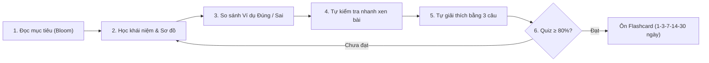

## 1. Quy trình học chuẩn cho mỗi bài

Để không rơi vào tình trạng "đọc thấy quen nhưng hỏi lại không giải thích được", mỗi bài học trên SDLC Academy được thiết kế theo chu trình **6 bước bắt buộc**:

1. **Đọc mục tiêu bài học (Bloom's Taxonomy):** Biết chính xác sau bài này bạn phải *nhớ*, *hiểu*, *áp dụng* hay *phân tích* được điều gì.
2. **Đọc lý thuyết & sơ đồ:** Tập trung hiểu *tại sao* khái niệm đó tồn tại và nó giải quyết vấn đề gì trong dự án phần mềm.
3. **Xem cặp Ví dụ Đúng / Sai:** Phân biệt rõ cách làm chuẩn và những sai lầm phổ biến nhất ngoài thực tế.
4. **Làm câu hỏi xen giữa bài (Active Recall):** Trả lời ngay trước khi lướt tiếp để ép não chủ động truy xuất kiến thức.
5. **Tự giải thích (Kỹ thuật Feynman):** Viết lại ý chính trong 3–4 câu bằng ngôn từ của bạn vào khung cuối bài, sau đó mới mở "Ý chính đối chiếu".
6. **Chinh phục Quiz ≥ 80%:** Nếu dưới 80%, đọc kỹ giải thích từng câu sai, xem lại đúng mục lý thuyết đó rồi làm lại.

:::tip[Thói quen 10 phút vàng mỗi ngày]
Trước khi mở bài mới, hãy vào trang [Ôn tập Flashcard](/on-tap-flashcard/) và hoàn thành toàn bộ các thẻ **Đến hạn hôm nay**. Chỉ mất 5–10 phút nhưng tăng gấp nhiều lần khả năng nhớ sau 1 tháng.
:::

---

## 2. Lịch học gợi ý trọn khóa (6 tuần, 45–60 phút/ngày)

### Tuần 1–2: Cấp 1 — Nền tảng & Các mô hình SDLC
| Ngày | Nội dung | Hoạt động bắt buộc |
|---|---|---|
| Ngày 1 | [Kiểm tra đầu vào](/kiem-tra-dau-vao/) | Xác định điểm mạnh/yếu hiện tại |
| Ngày 2–5 | [M0.1 Tổng quan SDLC](/cap-1-nen-tang/m0-tong-quan-sdlc/) & [M0.2 Vai trò & ISO 12207](/cap-1-nen-tang/m0-vai-tro-va-chuan/) | Quiz ≥ 80% + ghi chú tự giải thích |
| Ngày 6–11 | [M1.1 Mô hình truyền thống](/cap-1-nen-tang/m1-mo-hinh-truyen-thong/), [M1.2 Agile & Hiện đại](/cap-1-nen-tang/m1-agile-va-hien-dai/), [M1.3 Chọn mô hình](/cap-1-nen-tang/m1-chon-mo-hinh/) | Thử công cụ chọn mô hình + Quiz ≥ 80% |
| Ngày 12–14 | [Bài tập Cấp 1 (LibCore)](/du-an-mo-phong/bai-tap-cap-1/) & [Kiểm tra cuối Cấp 1](/cap-1-nen-tang/kiem-tra-cap-1/) | Tự chấm Rubric + Thi 20 câu bấm giờ (≥ 80%) |

### Tuần 3–4: Chuyên đề Agile & Scrum Chuyên sâu (*Scrum Guide 2020* & *Agile For Dummies*)
| Ngày | Nội dung | Hoạt động bắt buộc |
|---|---|---|
| Ngày 15–18 | [AS.0 Roadmap to Value](/agile-scrum/as0-lo-trinh-gia-tri-agile/) & [AS.1 12 Nguyên tắc & 5 Giá trị Scrum](/agile-scrum/as1-tuyen-ngon-va-tu-duy/) | Quiz ≥ 80% + viết thử Elevator Statement |
| Ngày 19–22 | [AS.2 Vận hành Scrum chi tiết](/agile-scrum/as2-van-hanh-scrum-chi-tiet/) & [AS.3 User Story, Splitting & Ước lượng](/agile-scrum/as3-backlog-user-story-uoc-luong/) | Quiz ≥ 80% + ôn Flashcard Agile |
| Ngày 23–25 | [AS.4 Phòng thực hành 12 Tình huống](/agile-scrum/as4-tinh-huong-thuc-chien/) & [AS.5 Lean, Scaling & Văn hóa](/agile-scrum/as5-lean-scaling-van-hoa/) | Xử lý tối ưu 12/12 ca + Quiz AS.5 ≥ 80% |
| Ngày 26–28 | [Bài tập Agile + Spot-the-Flaw](/du-an-mo-phong/bai-tap-agile-scrum/) & [Bài thi PSM I (20 câu)](/agile-scrum/kiem-tra-agile-scrum/) | Soi đủ 6 lỗi ẩn + Thi 20 câu bấm giờ (≥ 80%) |

### Tuần 5–6: Cấp 2 — Đi sâu 7 Giai đoạn SDLC (M2 → M10)
| Ngày | Nội dung | Hoạt động bắt buộc |
|---|---|---|
| Ngày 29–32 | [M2 Lập kế hoạch & TELOS](/cap-2-giai-doan/m2-lap-ke-hoach-kha-thi/) & [M3–M4 Yêu cầu FR/NFR & SRS](/cap-2-giai-doan/m3-4-yeu-cau-va-srs/) | Quiz ≥ 80% + xem Mẫu Business Case |
| Ngày 33–36 | [M5–M6 Mô hình hóa & Thiết kế](/cap-2-giai-doan/m5-6-mo-hinh-hoa-va-thiet-ke/) & [M7 Phát triển & CI/CD](/cap-2-giai-doan/m7-phat-trien-va-qlcm/) | Quiz ≥ 80% + đọc sơ đồ Sequence & State |
| Ngày 37–40 | [M8 Kiểm thử ISTQB v4.0](/cap-2-giai-doan/m8-kiem-thu-phan-mem/) & [M9–M10 Triển khai, Bảo trì & ITIL](/cap-2-giai-doan/m9-10-trien-khai-van-hanh/) | Thành thạo BVA, Bảng quyết định & 4 loại bảo trì |
| Ngày 41–42 | [Bài tập Cấp 2 (LibCore)](/du-an-mo-phong/bai-tap-cap-2/) & [Kiểm tra cuối Cấp 2](/cap-2-giai-doan/kiem-tra-cap-2/) | Tự chấm Rubric + Thi 20 câu bấm giờ (≥ 80%) |

---

## 3. Thước đo thành thạo khách quan

Khóa học bám sát phần kiến thức SDLC của 3 chứng chỉ quốc tế uy tín để bạn có thể tự đánh giá khách quan năng lực của mình:
- **ISTQB CTFL v4.0** (Chương 1 & Chương 2: Kiểm thử trong bối cảnh SDLC, V-Model, Shift-Left, QA/QC).
- **IIBA BABOK v3 / ECBA** (Vai trò BA, Stakeholder, RACI, quản trị yêu cầu).
- **Scrum.org PSM I / Scrum Guide 2020** (Tư duy Agile, 3 trách nhiệm – 5 sự kiện – 3 artifact – DoD).
